# Hướng dẫn workflow hệ thống đặt cơm PNJP – từng case

Tài liệu cho **dev**: giải thích **ai làm gì, lúc nào, trên trang nào, thấy gì**, từ bức tranh tổng thể tới từng bước, kèm ảnh chụp màn hình để bạn tự tái hiện mọi case trên máy local.

- Nguồn: `docs/plan.md` (v1.4), các `docs/demo-*.md` và code hiện tại. P0–P4 đã build; P5 (Giao nhận), P6 (Báo cáo, Nhật ký) **chưa có**.
- Nhãn màn hình, nút và thông báo trích từ `apps/web/src/messages/vi.ts`.
- Mã quy tắc (BR-xx) tra trong `docs/plan.md` mục 2.
- **Ảnh** nằm trong `docs/workflow-guide/`, chụp ngày 12/11/2026 trên bản build của nhánh này: seed mặc định, giờ giả, DMP giả. Các con số trong ảnh (28 người có suất, 29 suất dự trù…) là kết quả khi chạy đúng kịch bản ở [mục 9](#9-kịch-bản-trọn-một-tuần-chạy-liền-mạch).

## Mục lục

1. [Tổng quan](#1-tổng-quan)
2. [Chuẩn bị môi trường để tái hiện](#2-chuẩn-bị-môi-trường-để-tái-hiện)
3. [Phần A – Thiết lập ban đầu](#3-phần-a--thiết-lập-ban-đầu)
4. [Phần B – Tuần N-1: thực đơn và đăng ký](#4-phần-b--tuần-n-1-thực-đơn-và-đăng-ký)
5. [Phần C – Sáng ngày D: chấm công và xử lý từng người](#5-phần-c--sáng-ngày-d-chấm-công-và-xử-lý-từng-người)
6. [Phần D – Đối soát, chốt số, điều chỉnh](#6-phần-d--đối-soát-chốt-số-điều-chỉnh)
7. [Phần E – Sau bữa trưa](#7-phần-e--sau-bữa-trưa)
8. [Phần F – Case đặc biệt về dữ liệu và phân quyền](#8-phần-f--case-đặc-biệt-về-dữ-liệu-và-phân-quyền)
9. [Kịch bản trọn một tuần (chạy liền mạch)](#9-kịch-bản-trọn-một-tuần-chạy-liền-mạch)
10. [Phụ lục](#10-phụ-lục)

---

## 1. Tổng quan

### 1.1 Hệ thống làm gì

Thay quy trình giấy + Excel đặt cơm trưa ở nhà máy PNJP Gò Vấp:

1. **Phòng Hành chánh (HC)** lập thực đơn tuần và công bố.
2. **Nhân viên** tự đăng ký, hoặc **quản trị bộ phận** nhập hộ cho công nhân, suất ăn cho tuần sau. Hết **23:59 thứ Năm** hệ thống chụp **dự trù** để gửi nhà cung cấp (NCC).
3. **Sáng ngày D**: nhân viên còn sửa đến **08:00**. Hệ thống lấy chấm công từ **DMP**; ai chưa chấm công lúc **08:10** thì suất bị **tạm hủy**. Quản lý (trên DMP) hoặc quản trị (trên hệ thống) xác nhận có mặt để khôi phục.
4. **08:30** HC **chốt số**, tải Excel gửi NCC. Đến **10:30** còn **điều chỉnh** được (cần lý do; thêm suất phải được NCC đồng ý). **12:00** hệ thống tự chốt nếu HC chưa chốt.
5. Sau bữa trưa: giao nhận, báo cáo, chi phí (P5–P6, chưa build).

### 1.2 Bốn vai trò và tài khoản demo

Vai trò **cộng dồn**: quản trị vẫn là nhân viên và vẫn tự đặt cơm.

| Vai trò             | Ngoài đời                                    | Phạm vi                         | Tài khoản demo                                                                      |
| ------------------- | -------------------------------------------- | ------------------------------- | ----------------------------------------------------------------------------------- |
| Nhân viên           | Mọi nhân viên đang làm theo DMP              | Bản thân + đầu mối của mình     | `PNJP000001` Nguyễn Văn An (Nhóm Nhẫn 1, đầu mối Tổ Nhẫn)                           |
| Quản trị bộ phận    | Thư ký phòng, người giữ máy tính bảng của tổ | Đơn vị được gán và mọi cấp dưới | `PNJP000002` Trần Thị Bình (Xưởng Chế tác); `PNJP000005` Võ Thị Em (Xưởng Kim hoàn) |
| Quản trị Hành chánh | Phòng Hành chánh                             | Toàn nhà máy                    | `PNJP000003` Lê Hoàng Cường                                                         |
| Quản trị hệ thống   | IT                                           | Toàn hệ thống                   | `PNJP000004` Phạm Minh Dũng                                                         |

Tài khoản đặc biệt: `PNJP000006` (Kho vận, chưa có đầu mối nhận cơm), `PNJP000007` (Tổ Sửa chữa, đầu mối thiếu tầng). **Mọi** nhân viên seed (`PNJP000001`…`PNJP001700`) có PIN ban đầu `123456` và phải đổi ở lần đăng nhập đầu.

### 1.3 Bản đồ màn hình theo vai trò

Menu có 3 nhóm. Không có quyền thì không thấy mục (API vẫn chặn riêng). "Sắp có" = mục bị làm mờ, chưa build.

| Nhóm                      | Route                   | Tên trên menu                                       | NV  | QT bộ phận  |  QT HC  | QT hệ thống |
| ------------------------- | ----------------------- | --------------------------------------------------- | :-: | :---------: | :-----: | :---------: |
| Thông tin suất ăn của tôi | `/today`                | Hôm nay                                             |  ✓  |      ✓      |    ✓    |      ✓      |
|                           | `/week`                 | Đăng ký tuần                                        |  ✓  |      ✓      |    ✓    |      ✓      |
|                           | `/team`                 | Đơn vị của tôi                                      |  ✓  |      ✓      |    ✓    |      ✓      |
|                           | `/history`              | Lịch sử                                             |  ✓  |      ✓      |    ✓    |      ✓      |
| Quản trị                  | `/admin/today`          | Hôm nay (quản trị)                                  |  –  | đơn vị mình | toàn NM |      –      |
|                           | `/admin/registrations`  | Đăng ký tuần (quản trị)                             |  –  | đơn vị mình | toàn NM |      –      |
|                           | `/admin/print`          | In phiếu đăng ký                                    |  –  | đơn vị mình | toàn NM |      –      |
|                           | `/admin/reconciliation` | Đối soát                                            |  –  |   chỉ xem   |    ✓    |      –      |
|                           | `/admin/delivery`       | Giao nhận                                           |  –  |   Sắp có    | Sắp có  |      –      |
|                           | `/admin/reports`        | Báo cáo                                             |  –  |   Sắp có    | Sắp có  |      –      |
|                           | `/admin/audit`          | Nhật ký hoạt động                                   |  –  |      –      | Sắp có  |   Sắp có    |
|                           | `/system`               | Hệ thống                                            |  –  |      –      |    –    |      ✓      |
| Master data               | `/admin/dishes`         | Thư viện món                                        |  –  |      –      |    ✓    |      –      |
|                           | `/admin/menu`           | Thực đơn tuần                                       |  –  |      –      |    ✓    |      –      |
|                           | `/admin/master`         | Nhà ăn, tầng, trung tâm chi phí                     |  –  |      –      |    ✓    |      ✓      |
|                           | `/admin/org`            | Vị trí địa lý nhận cơm (tiêu đề: "Đơn vị nhận cơm") |  –  |      –      |    ✓    |      ✓      |
|                           | `/admin/employees`      | DS nhân viên theo CCTC (tiêu đề: "Nhân viên")       |  –  | đơn vị mình |    ✓    |      ✓      |
|                           | `/admin/settings`       | Cài đặt                                             |  –  |      –      |    ✓    |      ✓      |

Trên cùng mọi trang có **vùng thông báo** (banner): thực đơn chưa công bố, đồng bộ chấm công lỗi, ngày chưa chốt số, thông báo đổi món cho nhân viên.

### 1.4 Dòng thời gian một tuần phục vụ

**Tuần N** là tuần được phục vụ cơm (bắt đầu thứ Hai). Mọi mốc là giờ Việt Nam và đọc từ **Cài đặt**.


| Mốc                          | Mặc định (Cài đặt)         | Ai bị ảnh hưởng | Điều gì xảy ra                                   | Quy tắc      |
| ---------------------------- | -------------------------- | --------------- | ------------------------------------------------ | ------------ |
| Thứ Sáu tuần N-2, 00:00      | –                          | HC              | Bắt đầu lập được thực đơn tuần N                 | BR-01        |
| Thứ Hai tuần N-1, 12:00      | `menu.publishWarnAt`       | HC              | Tuần N chưa công bố → banner vàng trên mọi trang | BR-06        |
| Hết thứ Năm tuần N-1 (23:59) | `registration.close`       | Tất cả          | Đóng đăng ký dự trù, chụp **dự trù** bất biến    | BR-03, BR-07 |
| Ngày D 07:00                 | `attendance.pollStart`     | Hệ thống        | Bắt đầu lấy chấm công mỗi 5 phút                 | BR-30        |
| Ngày D 08:00                 | `day.lockTime`             | Nhân viên       | Khóa: nhân viên không tự sửa ngày D nữa          | BR-24        |
| Ngày D 08:10                 | `attendance.cutoff`        | Hệ thống        | Có suất mà chưa có mặt → **Tạm hủy**             | BR-31        |
| Ngày D 08:30                 | `close.time`               | HC              | Mở nút **Chốt số**                               | BR-43        |
| Ngày D 08:45                 | `close.reminderAt`         | HC              | Banner nhắc nếu chưa chốt                        | BR-43        |
| Ngày D 10:30                 | `close.adjustmentDeadline` | HC              | Hết điều chỉnh; ngừng đồng bộ chấm công          | BR-46, BR-32 |
| Ngày D 12:00                 | `close.autoFinalizeAt`     | Hệ thống        | Tự chốt nếu HC chưa chốt                         | BR-43        |
| Ngày D 15:00                 | `delivery.confirmDeadline` | QT bộ phận      | Hạn xác nhận giao nhận (P5, chưa build)          | BR-51        |

### 1.5 Các con số và trạng thái

| Tên trên màn hình | Nghĩa                                                                        | Khi nào có                |
| ----------------- | ---------------------------------------------------------------------------- | ------------------------- |
| **Dự trù**        | Ảnh chụp đăng ký lúc đóng đăng ký tuần. Không bao giờ đổi.                   | Từ 23:59 thứ Năm tuần N-1 |
| **Thực tế**       | Đăng ký hiện tại trừ suất của người tạm hủy/vắng. Đổi liên tục đến khi chốt. | Đến lúc chốt              |
| **Đã chốt**       | Ảnh chụp lúc chốt, gửi NCC. Không bao giờ đổi.                               | Từ lúc chốt               |
| **Điều chỉnh**    | Tổng các dòng điều chỉnh sau chốt (+/−).                                     | Sau chốt, trước 10:30     |
| **Hiệu lực**      | Đã chốt + Điều chỉnh. Dùng cho giao nhận, chi phí, báo cáo.                  | Sau chốt                  |

- **Tuần thực đơn** (`/admin/menu`): Chưa tạo → Bản nháp → Đã công bố → Đã chốt dự trù.
- **Cửa sổ sửa của một ngày**, nhìn từ nhân viên: trước hạn tuần (sửa tự do) → sau hạn tuần, trước 08:00 ngày D ("Sửa đến 08:00", mọi khác biệt so với dự trù đều hiện) → "Đã khóa" (chỉ quản trị sửa, có lý do) → Đã chốt số (chỉ HC điều chỉnh).
- **Chấm công của một người ngày D**: Chưa chấm công → Có mặt / Tạm hủy (08:10) → Vắng (khi chốt, tạm hủy thành hủy hẳn).

---

## 2. Chuẩn bị môi trường để tái hiện

### 2.1 Khởi động

Cần Node ≥ 22.12, pnpm 9, JDK 25. Từ thư mục gốc repo:

```bash
pnpm install
```

```bash
cp .env.example .env
```

Terminal 1 (giữ chạy; PostgreSQL không chạy dưới quyền root):

```bash
pnpm db:local
```

Terminal 2:

```bash
pnpm db:seed
```

```bash
pnpm dev
```

Mở http://localhost:3000. `.env` mặc định đã bật `CLOCK_FAKE_ENABLED=true` (giờ giả), `DMP_MODE=mock` (DMP giả), `ENTRA_MODE=mock` (SSO giả).

> **Seed có gì:** 1 nhà máy, 1 nhà ăn (Nhà ăn Gò Vấp), 4 tầng, 10 trung tâm chi phí, cây tổ chức 6 cấp, 1.700 nhân viên, 4 loại món (Mặn, Chay, Cháo, Eat clean). **Không có món, thực đơn, đăng ký nào**: phải làm Case A7 và B1 trước khi đặt cơm.

### 2.2 Điều khiển giờ giả

Giao diện **không** có nút đổi giờ; dùng API với phiên của quản trị hệ thống. Lưu ý:

- Giờ giả **đứng yên**, không tự chạy. Muốn qua 08:10 thì phải đặt lại giờ.
- Giờ giả **mất khi restart API**: sau mỗi lần restart phải đặt lại.
- Job nền (lấy chấm công, chốt tuần, tạm hủy 08:10, tự chốt 12:00) chạy **mỗi phút theo giờ thật** nhưng dùng giờ giả. Sau khi đổi giờ, chờ tối đa 1 phút, hoặc HC bấm **Chạy lại đồng bộ** (làm ngay việc lấy chấm công, nghỉ phép và mốc 08:10).
- Phiên đăng nhập sống 12 giờ (`SESSION_TTL_HOURS`) tính theo giờ giả: nhảy xa thì bị đẩy về `/login`, đăng nhập lại.

Đăng nhập `PNJP000004` trên web một lần để đổi PIN (ví dụ `246810`). Rồi trong một terminal, lưu phiên vào `.clock-jar`:

```bash
curl -s -c .clock-jar -H 'content-type: application/json' -d '{"employeeCode":"PNJP000004","pin":"246810"}' localhost:3001/api/auth/pin/login
```

Đặt giờ (thay thời điểm theo case):

```bash
curl -s -b .clock-jar -X PUT localhost:3001/api/dev/clock -H 'content-type: application/json' -d '{"at":"2026-11-23T08:10:00+07:00"}'
```

Xem giờ hệ thống đang dùng:

```bash
curl -s -b .clock-jar localhost:3001/api/dev/clock
```

Về giờ thật:

```bash
curl -s -b .clock-jar -X PUT localhost:3001/api/dev/clock -H 'content-type: application/json' -d '{"at":null}'
```

Nếu curl trả 401 (phiên hết hạn vì giờ giả), chạy lại lệnh đăng nhập.

### 2.3 Đổi kịch bản DMP giả

Sửa `DMP_MOCK_SCENARIO` trong `.env`, restart API, rồi **đặt lại giờ giả**. Kịch bản chỉ tác động lên `PNJP000008`–`PNJP000020`; mọi người khác chấm công 07:45.

| Kịch bản             | DMP trả về                                                            | Case      |
| -------------------- | --------------------------------------------------------------------- | --------- |
| `on-time`            | Mọi người vào 07:45                                                   | C3        |
| `forgot-to-check-in` | 008–020 không có dòng chấm công                                       | C4, D1–D7 |
| `late-record`        | 008–020 vào 08:05, dữ liệu về DMP lúc 08:20                           | C5        |
| `late`               | 008–020 vào 08:15                                                     | C6        |
| `manager-confirmed`  | 008–014 không chấm công, 015–020 vào 08:25; quản lý xác nhận trên DMP | C7, D5    |
| `morning-leave`      | 008–020 nghỉ sáng, vào 13:00                                          | C8        |
| `afternoon-leave`    | 008–020 nghỉ chiều, vào 07:45                                         | C8        |
| `api-error`          | Mọi lần gọi đều lỗi                                                   | C9        |
| `too-little-data`    | Chỉ khoảng 30% nhân viên đầu (đến `PNJP000510`) có dòng               | C9        |

> **Bẫy:** `PNJP000008`–`PNJP000013` thuộc **Chuyền A**, chưa có đầu mối nhận cơm, nên **không đặt cơm được** qua giao diện (trừ khi đặt đầu mối tập trung, case F1). Hãy dùng **`PNJP000014`–`PNJP000020`** (Nhóm Nhẫn 1, đầu mối Tổ Nhẫn) làm "người bị ảnh hưởng", và `PNJP000001`, `PNJP000021`–`PNJP000040` làm "người đi làm bình thường".

> **Đổi kịch bản trước khi qua 07:00 ngày D.** Nếu job đã ghi nhận chấm công theo kịch bản cũ cho ngày đó, đổi sau sẽ cho kết quả lẫn lộn. Mỗi kịch bản nên chạy trên một ngày riêng.

### 2.4 Lịch mẫu

**Tuần N = tuần 48, thứ Hai 23/11/2026 – Chủ nhật 29/11/2026.**

| Thời điểm                     | Ý nghĩa                                         |
| ----------------------------- | ----------------------------------------------- |
| Thứ Sáu 13/11 00:00           | Bắt đầu lập được thực đơn tuần 48               |
| Thứ Hai 16/11 12:00           | Bắt đầu cảnh báo nếu chưa công bố               |
| Thứ Năm 19/11 23:59           | Hạn đăng ký dự trù (lưu là 00:00 thứ Sáu 20/11) |
| Thứ Hai 23/11 – thứ Sáu 27/11 | Ngày D, mỗi ngày một kịch bản DMP               |
| Tuần 49 (30/11, 01/12)        | Hai ngày cho kịch bản nghỉ phép                 |

Định dạng giờ giả: `2026-11-17T10:00:00+07:00`.

---

## 3. Phần A – Thiết lập ban đầu

Seed đã có sẵn phần lớn. Để chạy các phần sau, tối thiểu cần **A1** (đăng nhập, đổi PIN) và **A7** (tạo món).

### Case A1 – Đăng nhập lần đầu, đổi PIN, SSO, khóa tài khoản

**Ai:** mọi người · **Trang:** `/login`, `/change-pin`, `/auth/not-linked`

1. Mở `/login`: nút **"Đăng nhập bằng SSO"** và form **Mã nhân viên** + **Mã PIN (6 chữ số)**. Nhập `PNJP000001` / `123456` → **Đăng nhập**.

   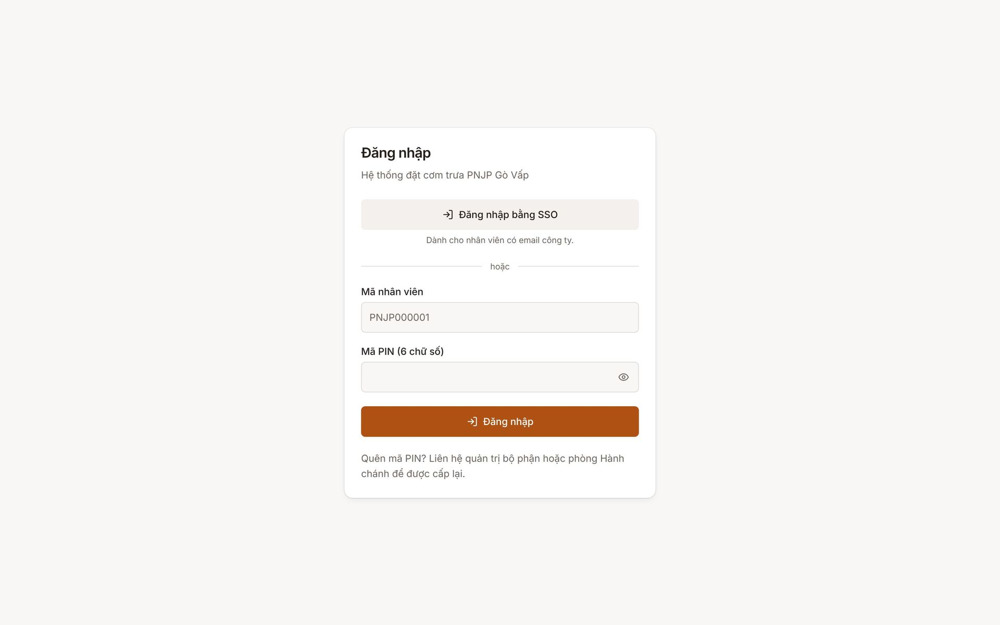

2. Bị chuyển sang `/change-pin` ("Đây là lần đăng nhập đầu tiên…"). Nhập **Mã PIN hiện tại** (`123456`), **Mã PIN mới** và **Nhập lại mã PIN mới** → **Đổi mã PIN**.

   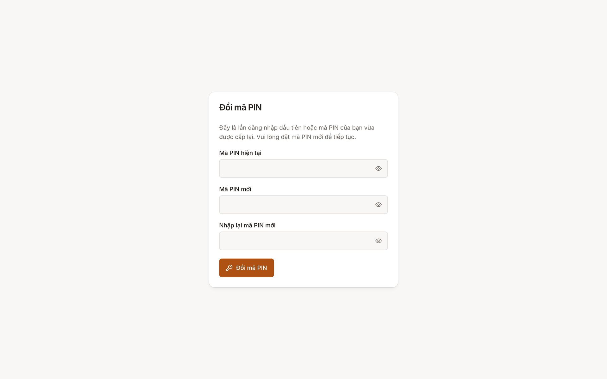

3. Vào `/today`. Nhân viên chỉ thấy nhóm "Thông tin suất ăn của tôi". Ngày không có thực đơn: "Hôm nay Nhà ăn Gò Vấp không phục vụ bữa trưa hoặc chưa có thực đơn."

   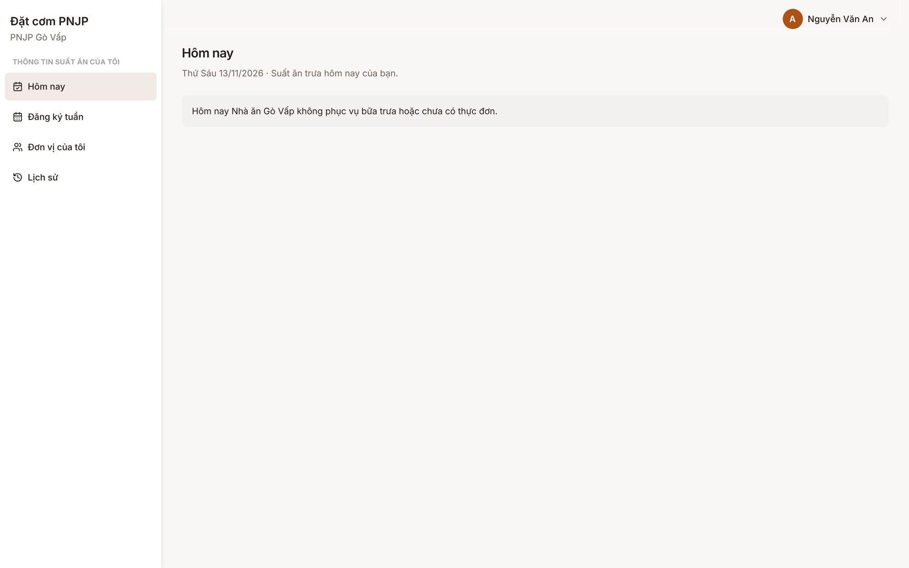

4. **SSO (giả):** bấm "Đăng nhập bằng SSO" → trang "Mock Microsoft sign-in" (chỉ có ở dev). Gõ `an.nguyen@pnjp.test` để vào thành `PNJP000001`.

   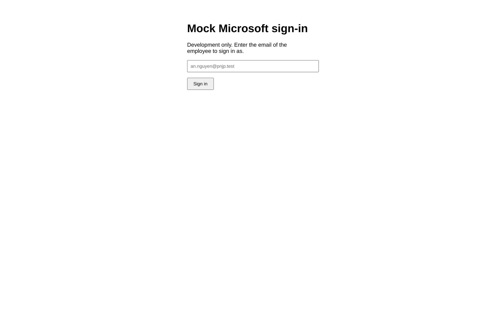

5. Gõ email không khớp nhân viên nào → "Tài khoản chưa được liên kết".

   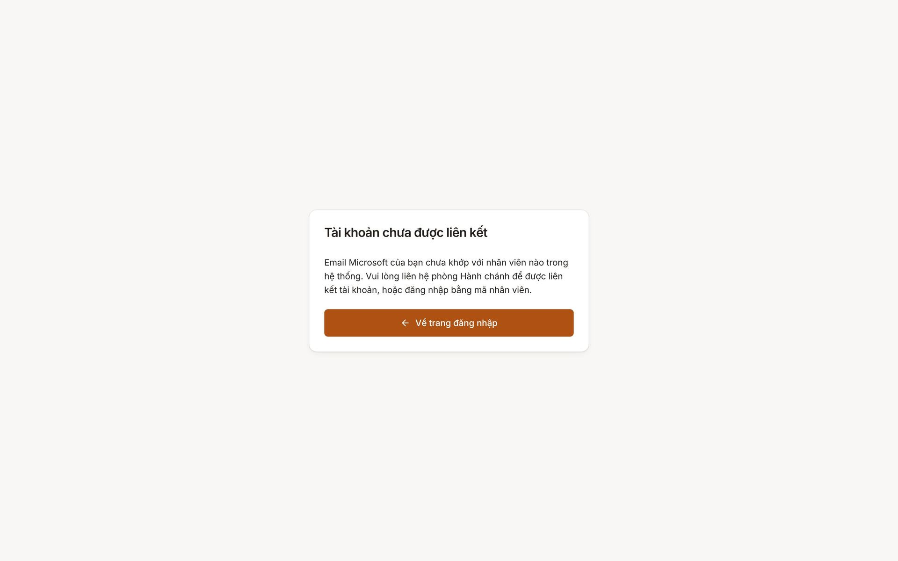

6. Nhập sai PIN 5 lần → "Tài khoản tạm khóa do nhập sai nhiều lần. Thử lại sau 09:15." (15 phút sau, theo Cài đặt).

   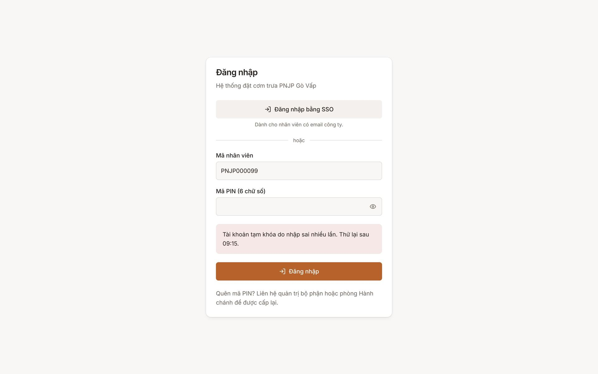

### Case A2 – Quản trị hệ thống gán vai trò, xem nhật ký đồng bộ

**Ai:** `PNJP000004` · **Trang:** `/system`

- "Quản trị Hành chánh và quản trị hệ thống": chọn nhân viên + vai trò → **Gán vai trò**; **Thu hồi** hỏi xác nhận.
- "Nhật ký đồng bộ": các lần đồng bộ Tổ chức và nhân viên / Chấm công / Nghỉ phép, trạng thái, số bản ghi, lỗi.
- Menu của quản trị hệ thống: không có các trang vận hành ngày (Hôm nay quản trị, Đối soát…), có danh mục, cài đặt, Hệ thống.

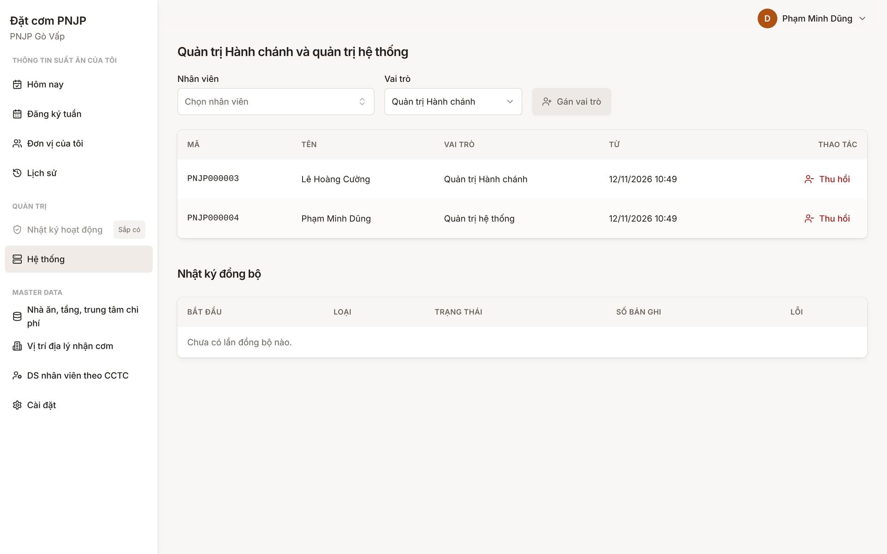

> Quản trị **bộ phận** được gán ở `/admin/org` (case A4), không ở đây.

### Case A3 – Danh mục nhà ăn, tầng, trung tâm chi phí

**Ai:** HC (`PNJP000003`) hoặc quản trị hệ thống · **Trang:** `/admin/master`

Ba tab **Nhà ăn**, **Tầng**, **Trung tâm chi phí**. Thêm, sửa, **Ngưng dùng** (không bao giờ xóa). Cột "Số đơn vị đang gán" cho biết mục nào đang dùng; ngưng dùng Tầng 1 (đang gán) bị từ chối. Quy tắc BR-62.

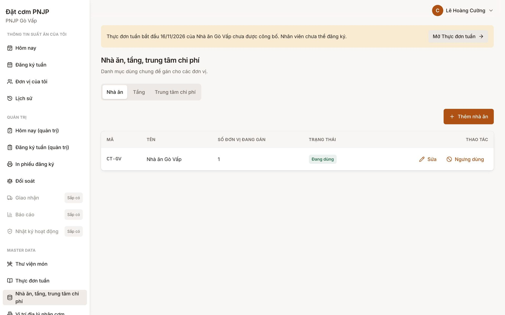

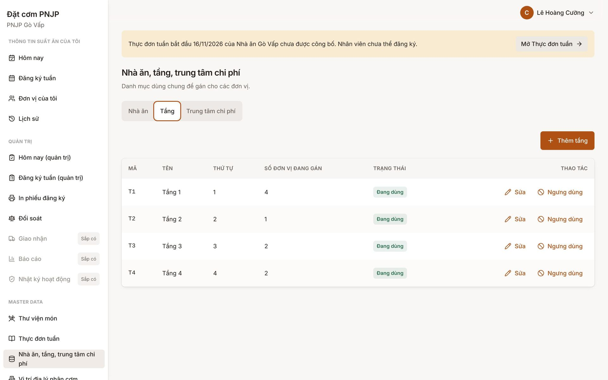

### Case A4 – Thiết lập đơn vị nhận cơm trên cây tổ chức

**Ai:** HC · **Trang:** `/admin/org` (menu "Vị trí địa lý nhận cơm")

**Đầu mối nhận cơm** = một nút trên cây nhận chung một thùng cơm. Nhân viên thuộc đầu mối gần nhất phía trên mình. Tầng và nhà ăn theo đầu mối; trung tâm chi phí theo từng nhân viên (kế thừa từ cây).

1. Tab **Cây tổ chức**: mỗi nút có nhãn "Đầu mối nhận cơm · N người", "Chưa có đầu mối · N người" hoặc "→ <đầu mối>". **Mở hết** / **Thu gọn**, ô lọc, "Chỉ xem đầu mối nhận cơm".

   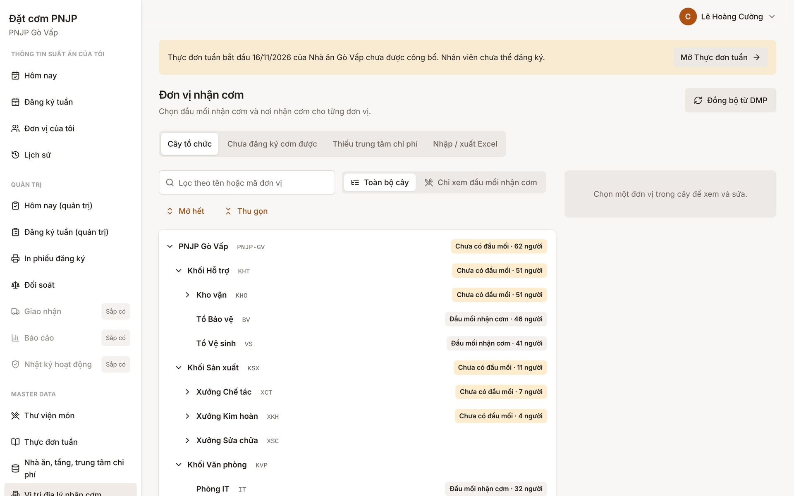

2. Chọn **Tổ Nhẫn**. Panel phải: "Đơn vị này có là đầu mối nhận cơm không?" (Có/Không), "Hiện trạng: Đầu mối của 296 nhân viên, nhận cơm tại Tầng 2 · Nhà ăn Gò Vấp", ô Tầng ("Kế thừa: Tầng 2 (từ Xưởng Chế tác)"), Nhà ăn, Chi phí, ô "Đầu mối nhận cơm tập trung" và phần gán **Quản trị bộ phận** ở cuối panel.

   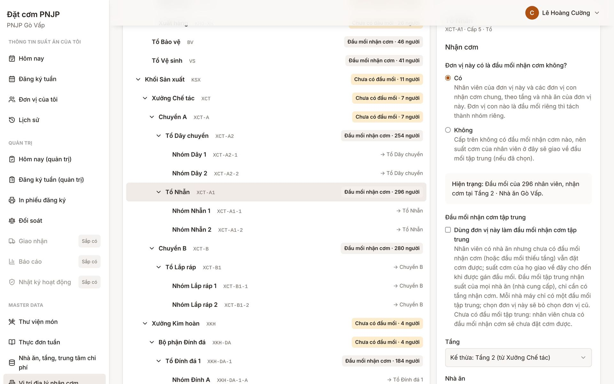

3. Tab **Chưa đăng ký cơm được**: ai không có đầu mối hợp lệ và lý do.

   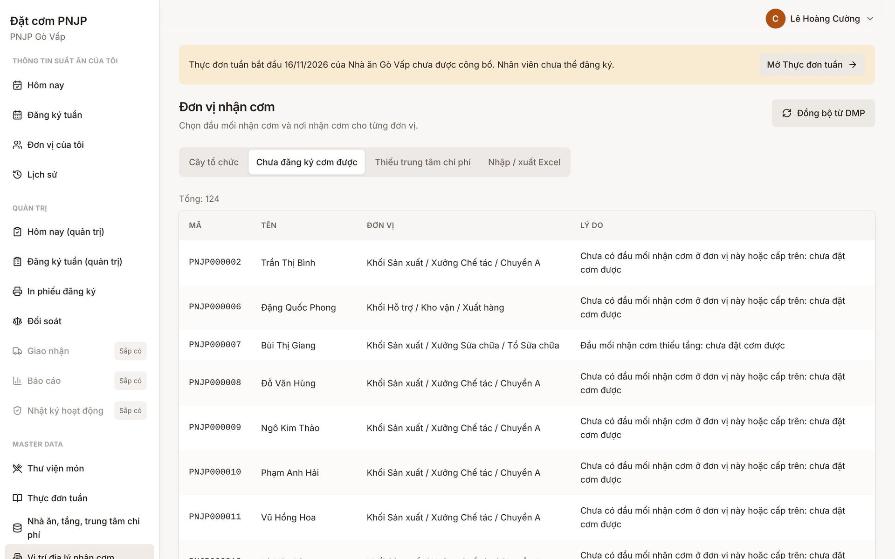

4. Tab **Nhập / xuất Excel**: **Tải xuống** mapping hiện tại → sửa → **Kiểm tra tệp**. Một dòng sai là cả tệp bị từ chối, kèm bảng lỗi theo dòng. Tệp đúng thì xem trước rồi **Áp dụng tất cả** (BR-64).

   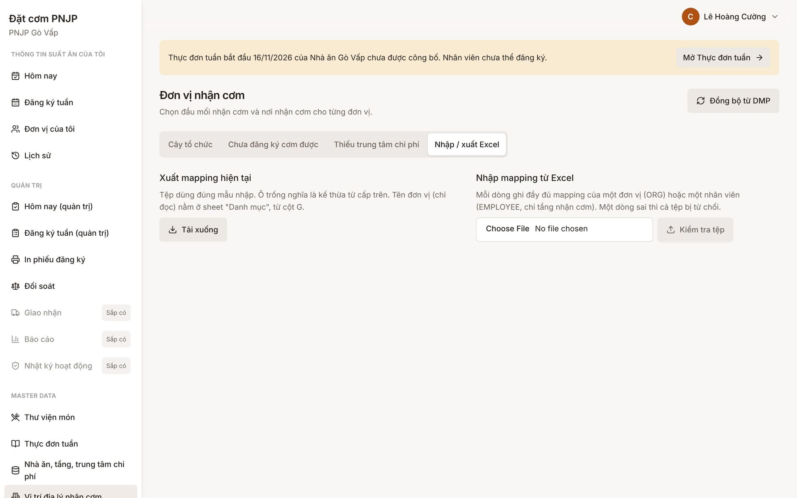

Tab **Thiếu trung tâm chi phí** liệt kê nhân viên chưa có trung tâm chi phí. Mọi thay đổi được ghi audit và không sửa dữ liệu dự trù/chốt đã chụp.

### Case A5 – Tra cứu nhân viên, cấp lại PIN, đổi tầng nhận cơm

**Ai:** HC, quản trị hệ thống (toàn nhà máy); quản trị bộ phận (chỉ đơn vị mình) · **Trang:** `/admin/employees`

1. Tìm theo tên/mã, lọc Khối, Trạng thái, **Thêm bộ lọc** (tầng, nhà ăn, trung tâm chi phí, tình trạng suất ăn). Cột Đầu mối nhận cơm hiện "Chưa có đầu mối nhận cơm" hoặc "Đầu mối thiếu tầng/nhà ăn" khi có vấn đề.

   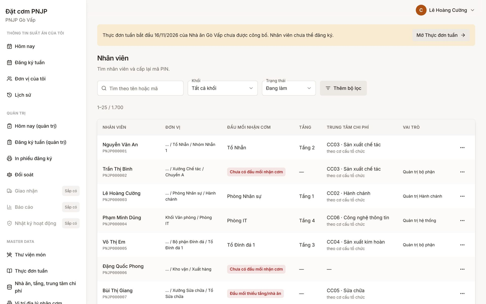

2. Nút "…" trên một dòng → **Đổi tầng nhận cơm** / **Cấp lại PIN**.

   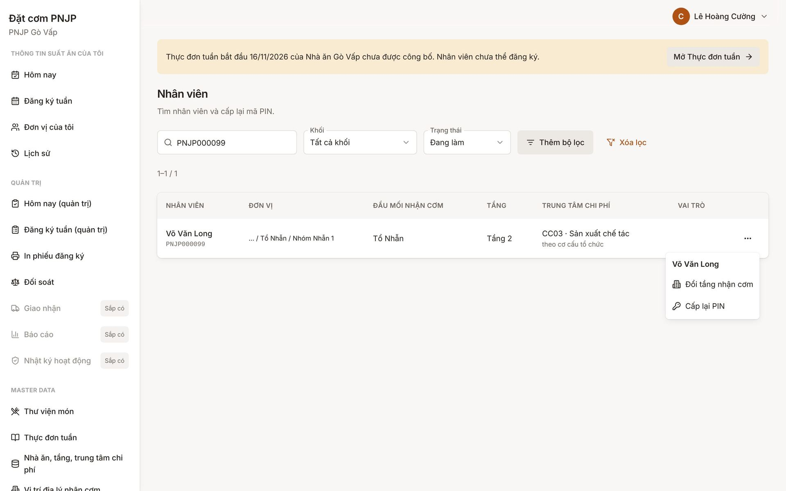

3. **Cấp lại PIN** → xác nhận (các phiên đăng nhập hiện tại bị đăng xuất) → hộp **Mã PIN tạm**, hiện **một lần duy nhất** (trong ảnh đã làm mờ). Nhân viên phải đổi PIN ở lần đăng nhập tới.

   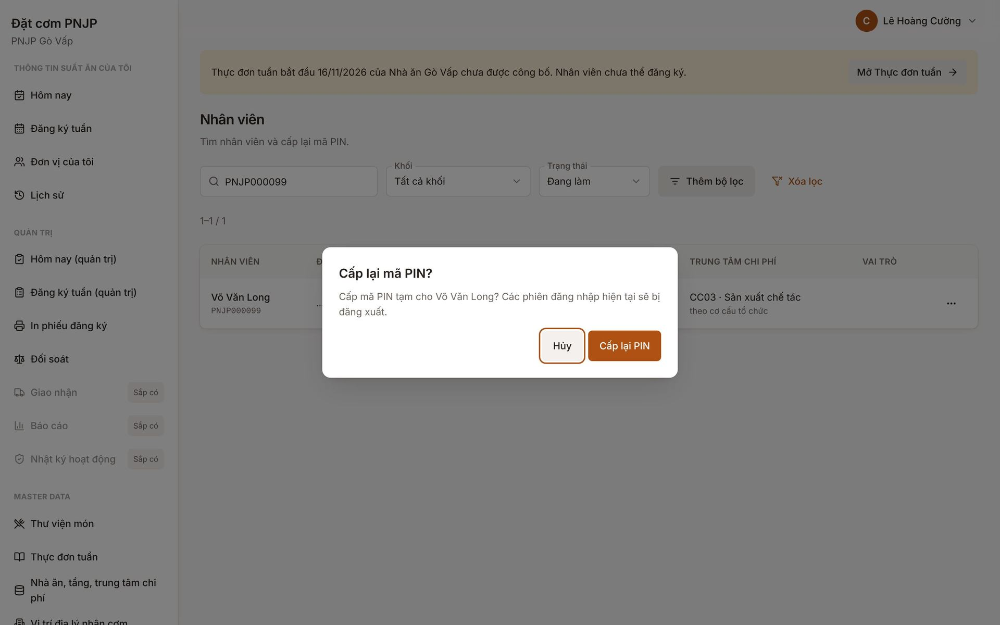

   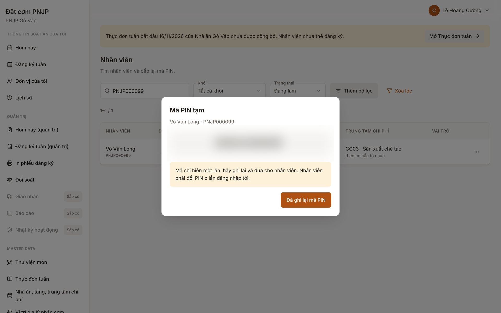

4. **Đổi tầng nhận cơm** (HC): chọn tầng, **Lý do (bắt buộc)** → Lưu. Cột Tầng thành "… · nhận riêng"; áp dụng từ lần chụp dự trù kế tiếp.

   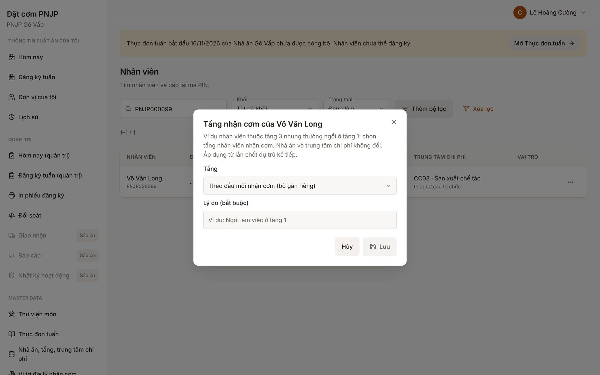

### Case A6 – Cài đặt mốc giờ và ngưỡng

**Ai:** HC, quản trị hệ thống · **Trang:** `/admin/settings`

1. Các nhóm Đăng ký, Ngày phục vụ, Chấm công, Chốt số và giao nhận, Mã PIN; khung "Nhà cung cấp suất ăn" (tên, đơn giá).

   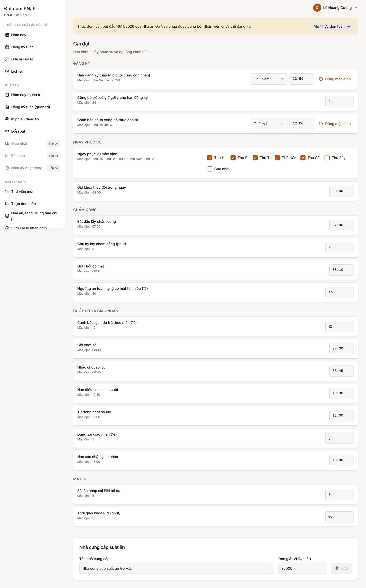

2. Sửa một giá trị (ví dụ "Giờ khóa thay đổi trong ngày" → gõ `0730` thành `07:30`): dòng được tô, thanh dưới hiện **Hủy thay đổi** / **Lưu thay đổi (1)**. Mọi thay đổi được audit.

   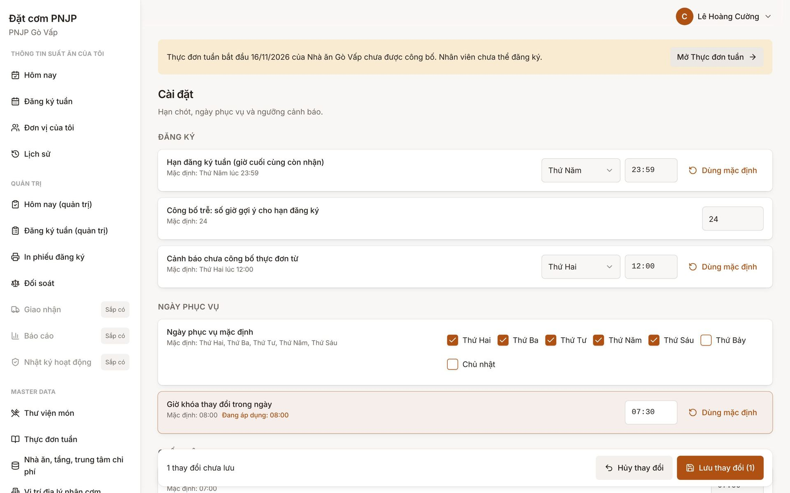

> Khi tái hiện, **giữ mặc định** để khớp tài liệu.

### Case A7 – Thư viện món

**Ai:** HC · **Trang:** `/admin/dishes` (mỗi nhà ăn một thư viện, chọn ở ô "Nhà ăn")

1. Ban đầu thư viện trống. Tab **Loại món** có sẵn Mặn (2–3 món/ngày), Chay (1), Cháo (1), Eat clean (không kiểm tra); **Thêm loại món** để tạo loại mới.

   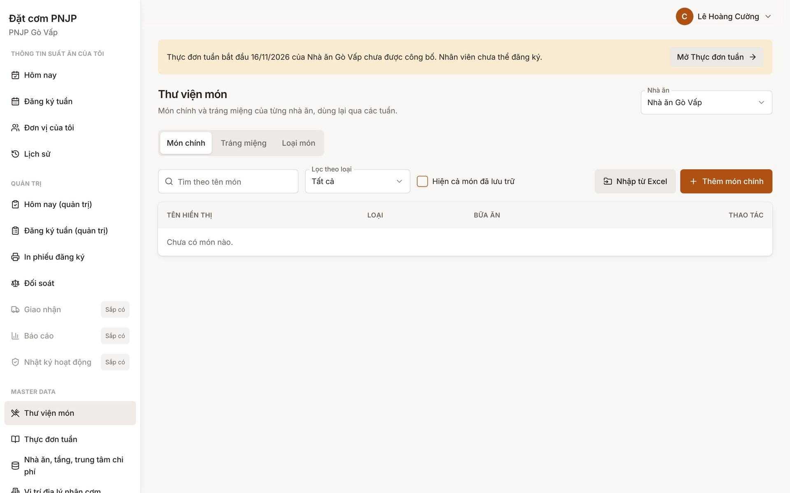

   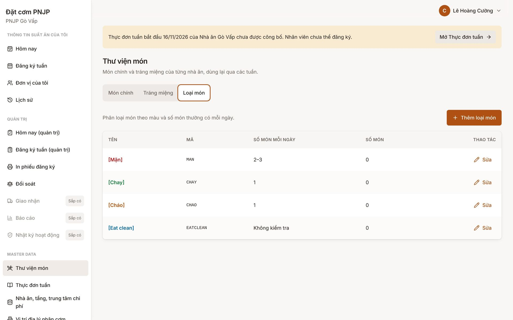

2. Tab **Món chính** → **Thêm món chính**: Tên + Loại. "Tên hiển thị: [Mặn] Cá kho tộ" (BR-12) → **Lưu**.

   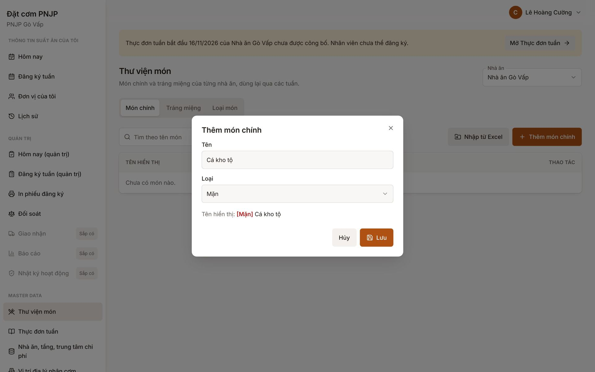

3. Tạo đủ cho thực đơn mẫu: Mặn "Cá kho tộ", "Thịt kho trứng", "Gà chiên mắm", "Bò lúc lắc"; Chay "Đậu hũ sốt cà", "Canh chua chay"; Cháo "Cháo gà".

   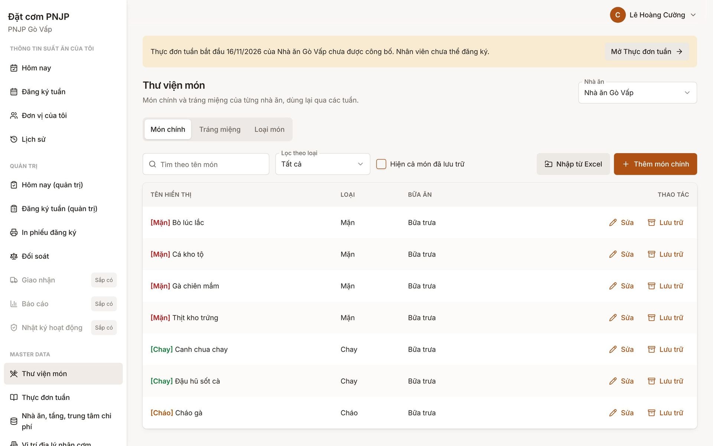

4. Thêm trùng tên (khác hoa thường, khoảng trắng): "Món này đã có trong thư viện của nhà ăn."

   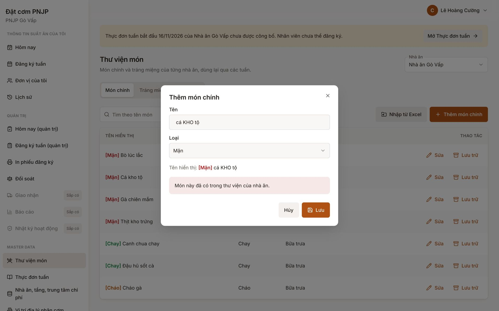

5. Tab **Tráng miệng** → **Thêm món tráng miệng**: "Chuối", "Rau câu", "Sữa chua". **Lưu trữ** một món thì món biến mất khỏi danh sách và thực đơn nhưng không bị xóa ("Hiện cả món đã lưu trữ" để khôi phục).

   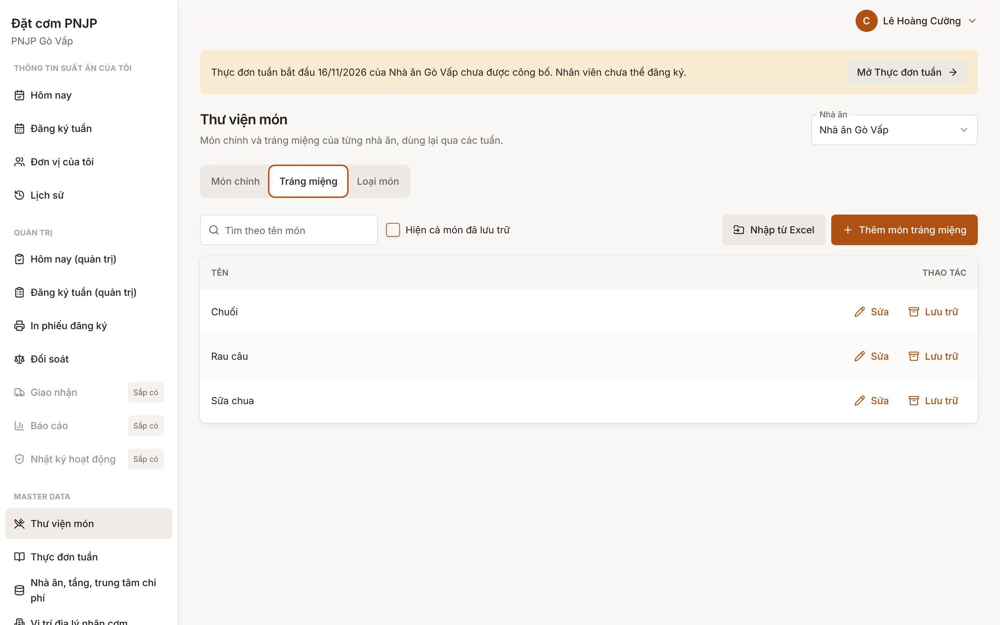

6. Nhanh hơn: **Nhập từ Excel** → **Tải tệp mẫu** → điền → **Kiểm tra tệp** → **Thêm n món**.

   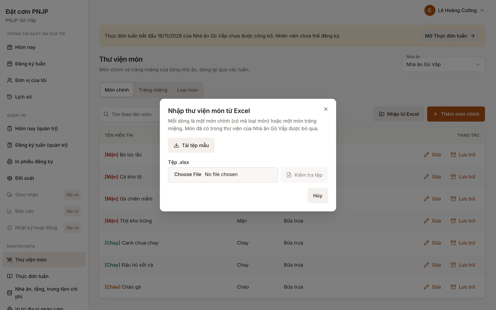

---

## 4. Phần B – Tuần N-1: thực đơn và đăng ký

### Case B1 – HC lập và công bố thực đơn đúng hạn (hành trình J5)

**Ai:** HC · **Giờ giả:** `2026-11-16T13:00:00+07:00` · **Trang:** `/admin/menu`

1. Banner vàng trên mọi trang: "Thực đơn tuần bắt đầu 23/11/2026 của Nhà ăn Gò Vấp chưa được công bố. Nhân viên chưa thể đăng ký." (BR-06, đã qua 12:00 thứ Hai). Vào **Thực đơn tuần**: tuần 48 chọn sẵn, badge "Chưa tạo", dòng "Nếu công bố bây giờ, hạn đăng ký là đến hết 19/11/2026 23:59." Trái là thư viện, phải là lưới thứ Hai–Chủ nhật.

   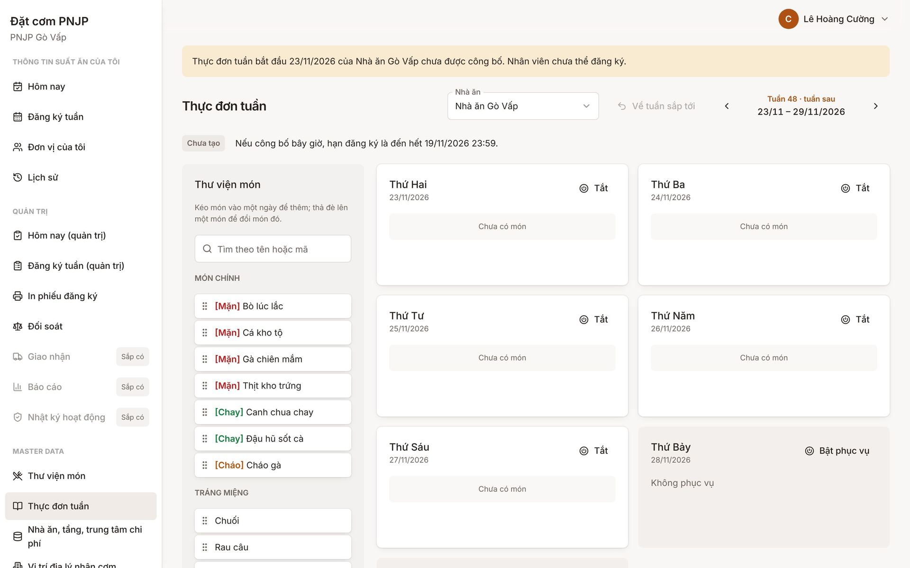

2. **Kéo** món từ thư viện thả vào một ngày ("Thêm vào Thứ Hai"); thả đè lên món có sẵn để đổi. Màn hình < 1024 px: nút **Thêm món** trên từng ngày.

   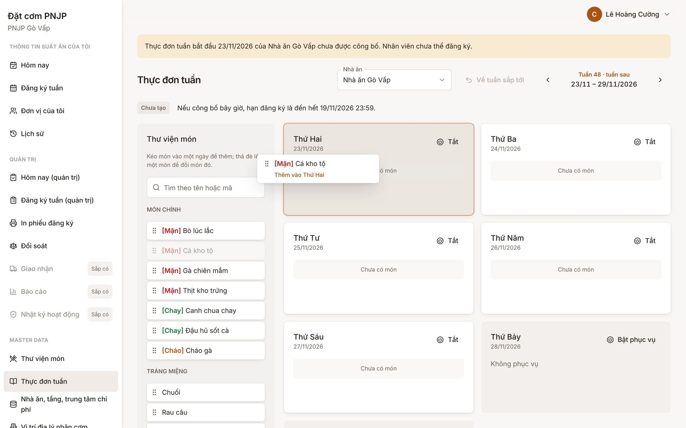

3. Điền thứ Hai–thứ Sáu (mỗi ngày ≥ 1 món chính + 1 tráng miệng). Thứ Bảy/Chủ nhật mặc định "Không phục vụ" (**Bật phục vụ** nếu cần; **Tắt** để đánh dấu nghỉ lễ – BR-08). Ngày có cơ cấu lạ hiện ghi chú vàng "Cơ cấu khác thường lệ: Chay có 2." – chỉ cảnh báo (BR-13). **Lưu nháp** → badge "Bản nháp"; nhân viên **chưa thấy** gì.

   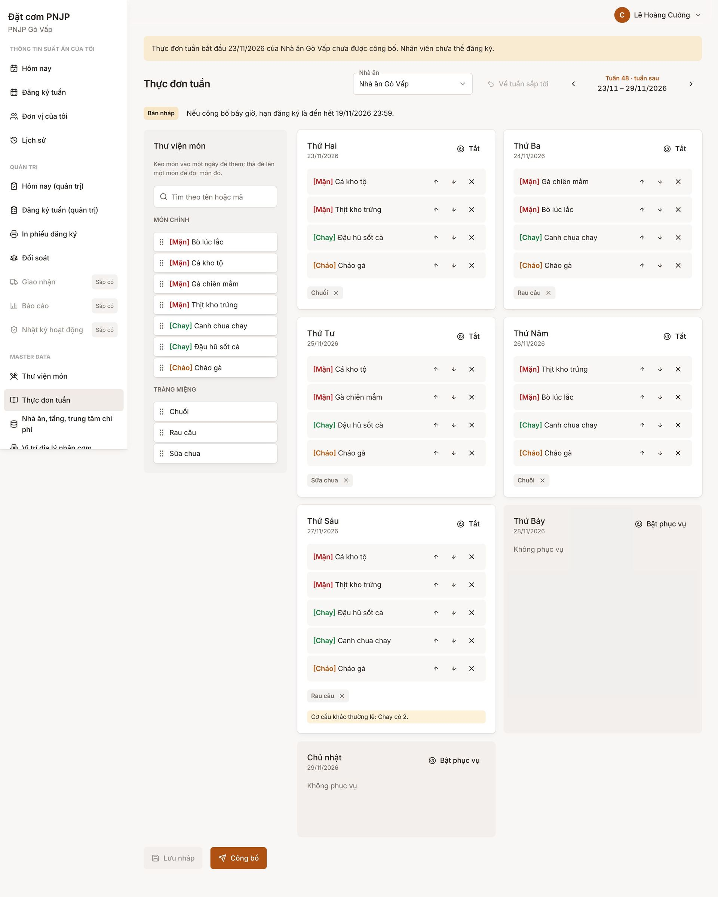

4. **Công bố** → "Công bố thực đơn? Nhân viên của nhà ăn này sẽ thấy thực đơn và đăng ký được ngay. Hạn đăng ký: đến hết 19/11/2026 23:59." → **Công bố**. Thiếu món chính hoặc tráng miệng ở một ngày phục vụ thì nút Công bố bị khóa và liệt kê ngày thiếu.

   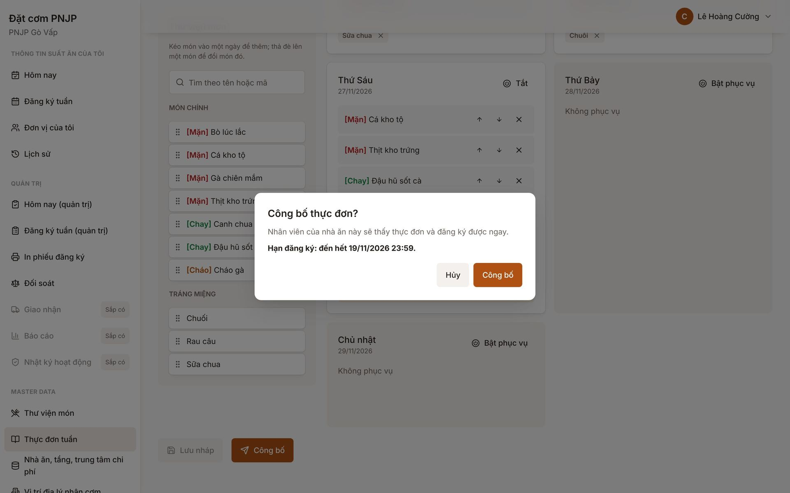

5. Badge "Đã công bố", banner vàng biến mất; từ giờ sửa thực đơn là "sửa sau công bố" (case B4).

   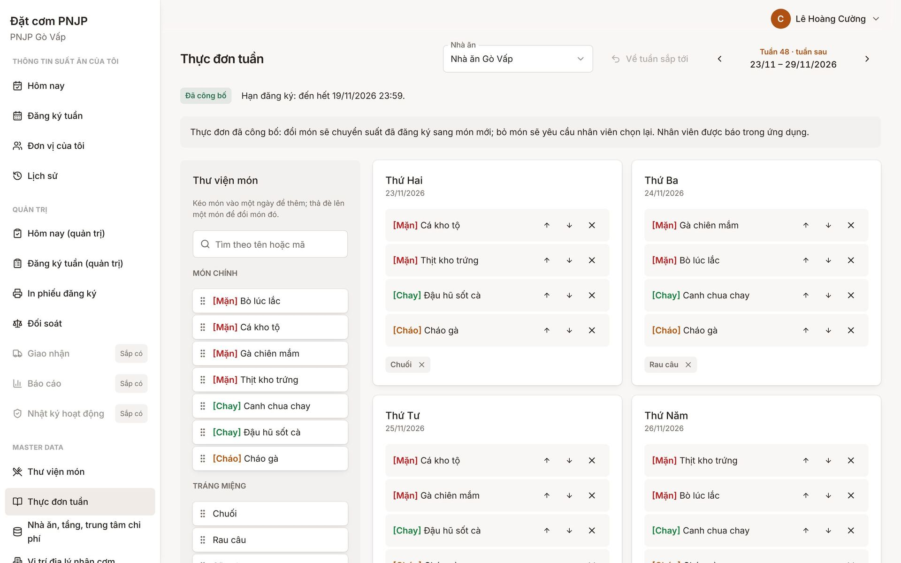

Quy tắc: BR-01 đến BR-03, BR-08, BR-11 đến BR-15.

### Case B2 – Công bố trễ (sau hạn thường lệ, trước thứ Hai tuần N)

**Ai:** HC · **Giờ giả:** thứ Bảy tuần N-1, 09:30 (ảnh: `2026-12-05T09:30:00+07:00`, tuần 50 chưa công bố)

1. `/admin/menu`: badge **"Công bố trễ: tự chọn hạn đăng ký"** và dòng "Đã qua hạn đăng ký thường lệ. Chọn hạn đăng ký dự trù, muộn nhất đến hết 06/12/2026 23:59."

   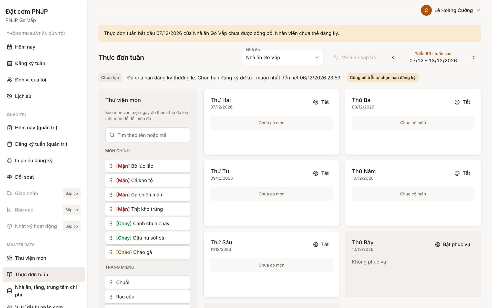

2. Khi mỗi ngày phục vụ đã có món, cuối trang (cạnh nút Công bố) có ô **"Hạn đăng ký dự trù (đến hết)"**, gợi ý sẵn = giờ công bố + 24 giờ, không vượt quá Chủ nhật 23:59. Chọn giờ → Công bố; dự trù được chụp đúng giờ đó.

Quy tắc: BR-04, BR-05.

### Case B3 – Công bố trong tuần phục vụ, và tuần đã qua

**Ai:** HC · **Giờ giả:** thứ Tư của tuần N chưa công bố (ảnh: `2026-12-16T10:00:00+07:00`, tuần 51)

1. `/admin/menu` mặc định mở **tuần sau**; bấm **Tuần trước** về tuần hiện tại. Badge "Công bố trong tuần" và dòng "Công bố trong tuần phục vụ: không có dự trù, mọi suất đăng ký đều tính là đăng ký thực tế." Sau khi công bố: thứ Hai–thứ Tư đã khóa, thứ Năm–thứ Sáu sửa đến 08:00 từng ngày.

   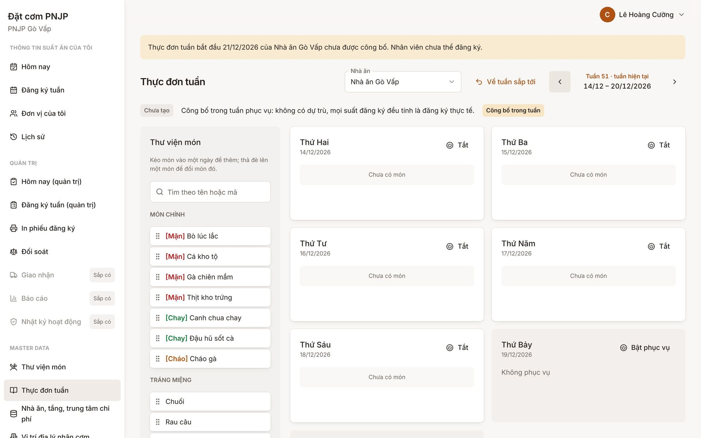

2. Lùi thêm một tuần (mọi ngày phục vụ đã khóa): "Tuần đã qua: mọi ngày phục vụ đều đã khóa nên không công bố được thực đơn. Bạn vẫn lưu nháp được để tham khảo." – không có nút Công bố.

   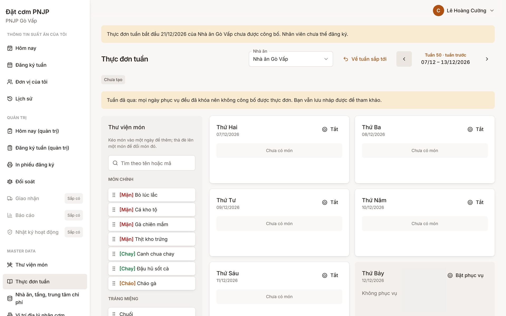

Quy tắc: BR-04.

### Case B4 – Sửa thực đơn đã công bố (NCC đổi món)

**Ai:** HC thao tác, nhân viên nhận thông báo · **Giờ giả:** `2026-11-18T09:00:00+07:00` · **Trang:** `/admin/menu`, `/today`, `/week`

Điều kiện: `PNJP000001` đã đăng ký "Gà chiên mắm" thứ Tư (case B5).

1. Kéo "Bò lúc lắc" từ thư viện **thả đè** lên "Gà chiên mắm" của thứ Tư ("Đổi món [Mặn] Gà chiên mắm"). Dưới màn hình (< 1024 px) dùng ô "Đổi thành". Bỏ món: nút ✕.

   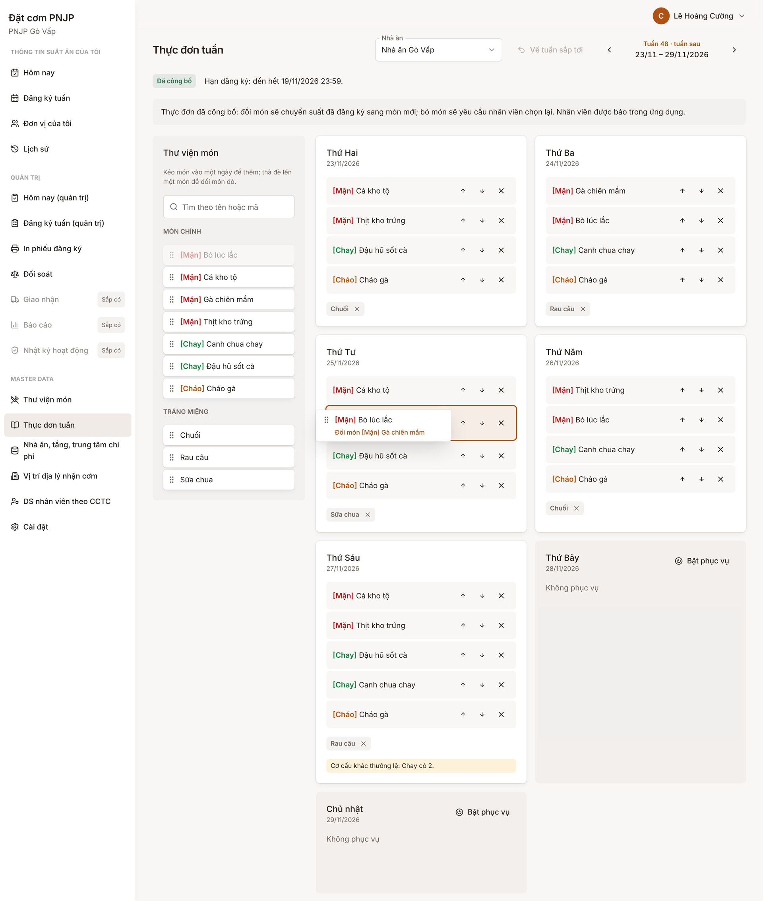

2. Nhập **Lý do (không bắt buộc)** ("Nhà cung cấp đổi món") → **Lưu thay đổi** → "Đã lưu. 1 suất được chuyển sang món mới, 0 suất cần chọn lại, 1 nhân viên được thông báo."

   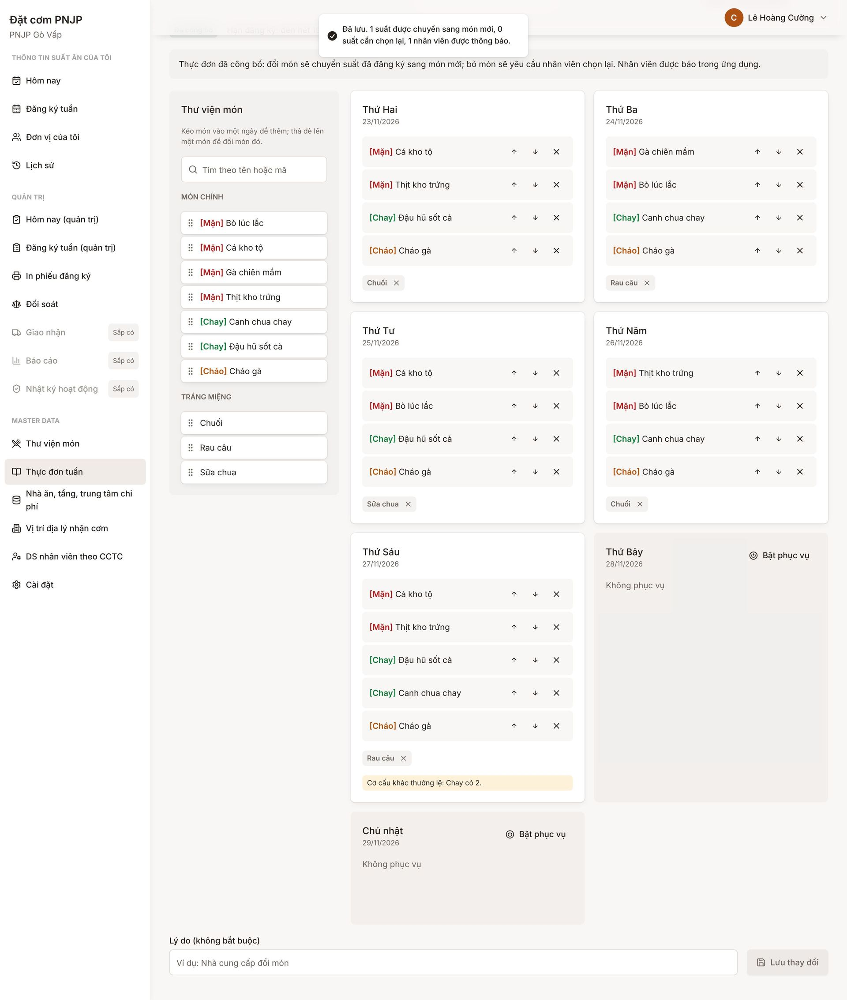

3. Nhân viên thấy trên đầu mọi trang: "Thực đơn ngày 25/11/2026: món [Mặn] Gà chiên mắm được đổi thành [Mặn] Bò lúc lắc. Suất bạn đã đăng ký đã chuyển sang món mới." (**Đã xem** để ẩn).

   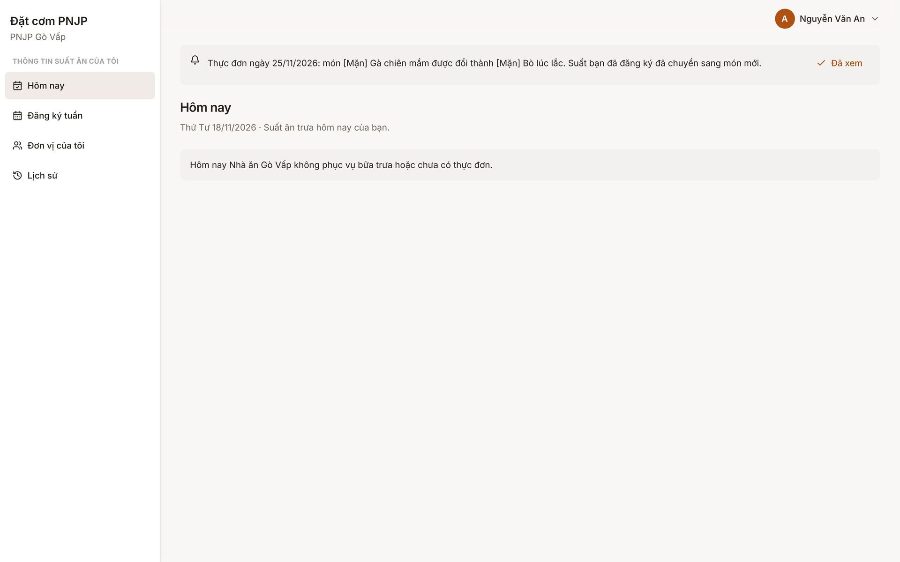

- **Bỏ món**: suất thành "Cần chọn lại"; thông báo có nút **Chọn lại món**. Không chọn lại trước 08:00 ngày đó thì suất bị hủy (job `reselect-deadline`, có audit).
- Đổi món **sau** hạn đăng ký: trên `/week` món mới hiện chữ đỏ "Đã đổi món: bạn đăng ký …, nhà ăn thay bằng món này."
- Ngày đã qua 08:00 bị khóa, không sửa thực đơn được.

Quy tắc: BR-14.

### Case B5 – Nhân viên văn phòng tự đăng ký tuần (hành trình J1)

**Ai:** `PNJP000001` · **Giờ giả:** `2026-11-17T10:00:00+07:00` · **Trang:** `/week`

1. Tuần 48 chọn sẵn. Chip "Nhà ăn Gò Vấp", "Hạn đăng ký: 19/11/2026 23:59", "Sửa từng ngày đến 08:00 sáng". Tab **Đăng ký dự trù** (tab **Đăng ký thực tế** chỉ mở sau hạn). Mỗi ngày một thẻ: các món, tráng miệng, tổng suất.

   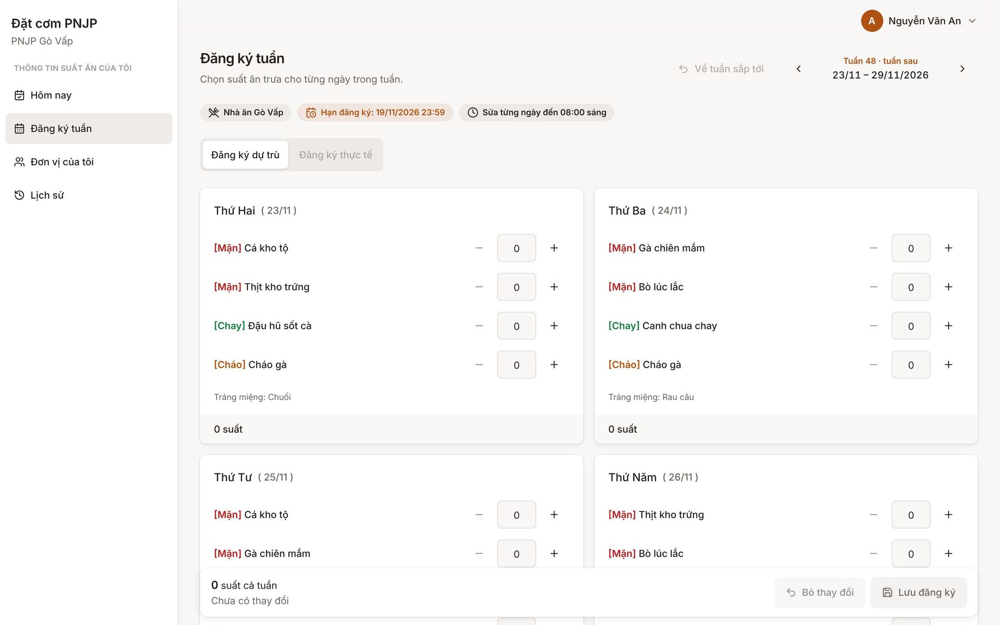

2. Bấm **+ / −**, từ 0, **không giới hạn** (2 suất cùng món, hay Mặn + Chay cùng ngày đều hợp lệ – BR-20). Thanh dưới: "7 suất cả tuần · Có thay đổi chưa lưu".

   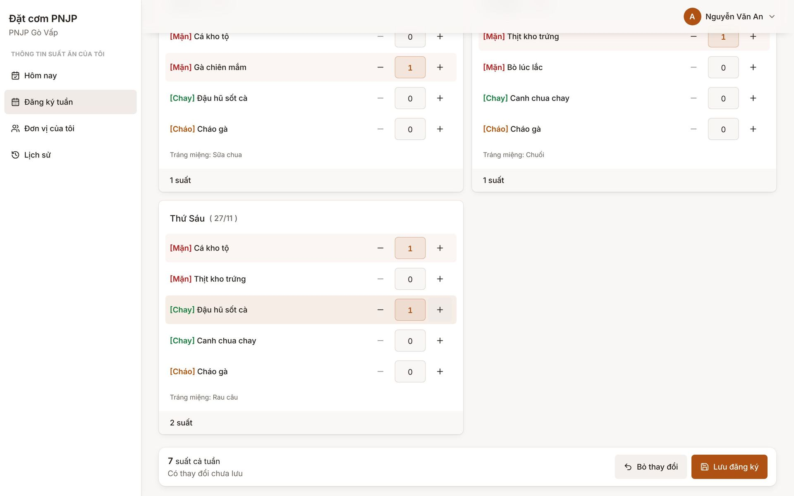

3. **Lưu đăng ký** → "Đã lưu. Tuần này bạn có 7 suất. Hạn đăng ký: đến hết 19/11/2026 23:59." Trước hạn sửa thoải mái (BR-22).

   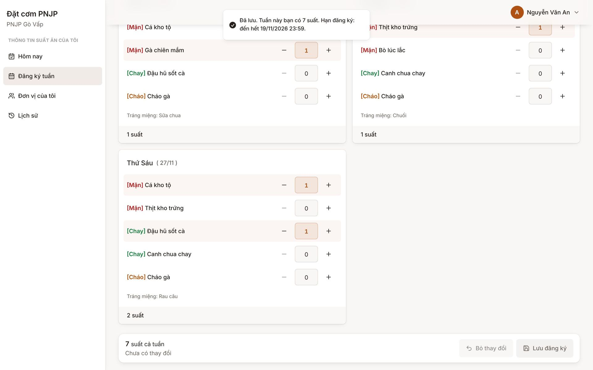

4. `PNJP000006` (Kho vận, không có nhà ăn/đầu mối): "Phòng ban của bạn chưa được thiết lập nhà ăn nên chưa thể đặt cơm…". Xem case F1 để gỡ.

   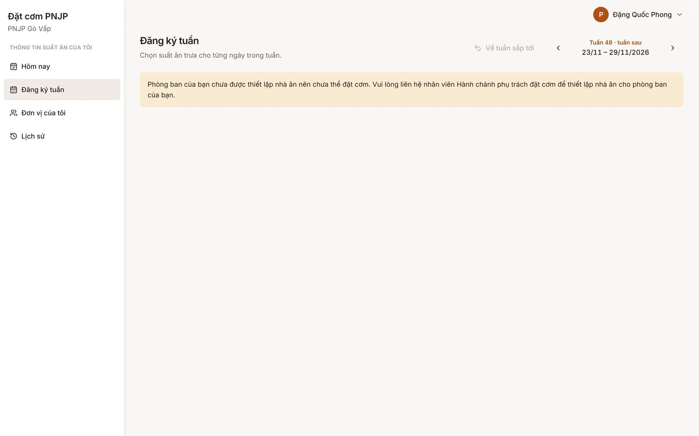

Tuần chưa công bố: "Thực đơn tuần này của Nhà ăn Gò Vấp chưa được công bố."

### Case B6 – Công nhân đăng ký bằng phiếu giấy (hành trình J2)

**Ai:** quản trị bộ phận `PNJP000002` · **Giờ giả:** `2026-11-17T10:30:00+07:00` · **Trang:** `/admin/print`, `/admin/registrations`

1. **In phiếu đăng ký**: chọn tuần 48 và **Đơn vị** "… / Tổ Nhẫn / Nhóm Nhẫn 1" → xem trước "PHIẾU ĐĂNG KÝ SUẤT ĂN TRƯA" → **In phiếu**.

   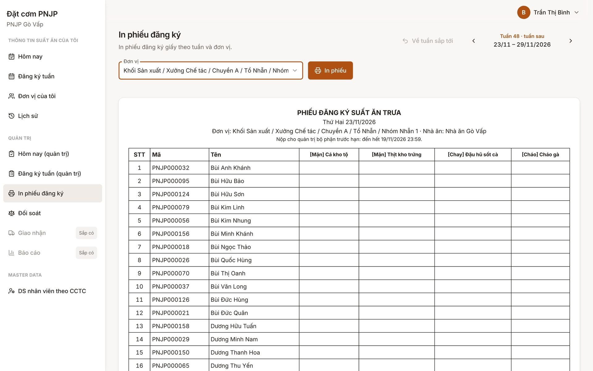

2. Bản in: mỗi ngày một trang, dòng là nhân viên (cùng thứ tự với bảng nhập), cột là món, ô trống để ghi số, dòng ký "Người tổng hợp". Công nhân ghi tay, nộp trước 23:59 thứ Năm.

   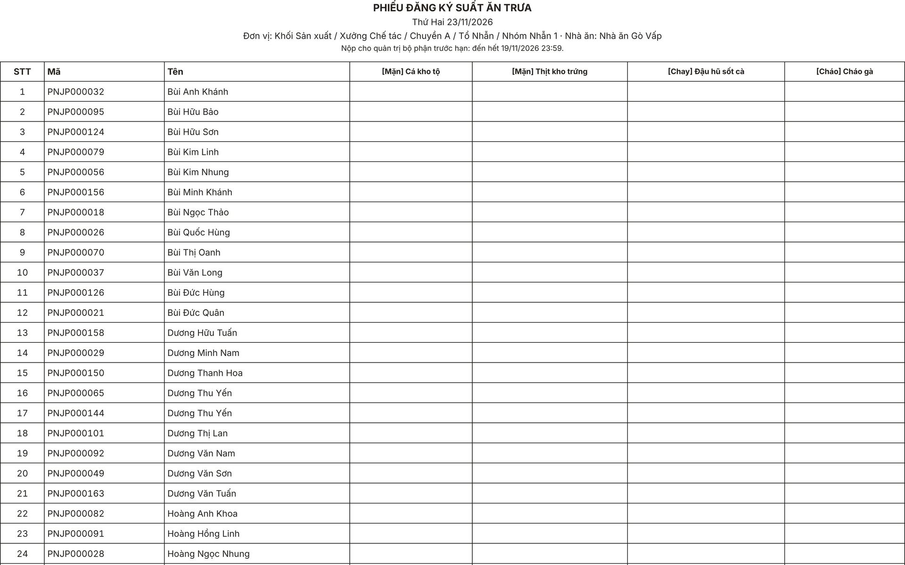

3. **Đăng ký tuần (quản trị)** → tab **Nhập theo bảng** → chọn cùng đơn vị. Tab theo ngày (T2 – 23/11 …), tìm tên/mã, **Lọc dòng**, cột món, cột Tổng.

   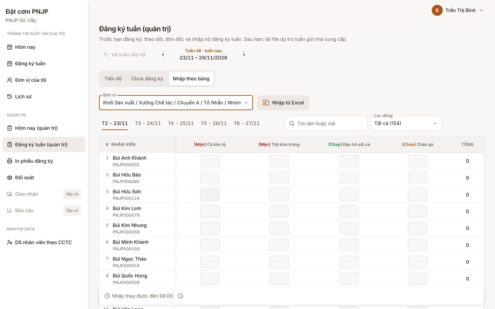

4. Gõ số; **Enter** xuống dòng, **Tab** sang phải. Ô sai (`x`, `1,5`, `-1`) làm dòng đỏ; thanh dưới "1 dòng có ô chưa hợp lệ · Xem dòng lỗi" và nút lưu bị khóa. Sửa xong → **Lưu ngày Thứ Hai** → "Đã lưu: n người thay đổi…". Lặp cho từng ngày.

   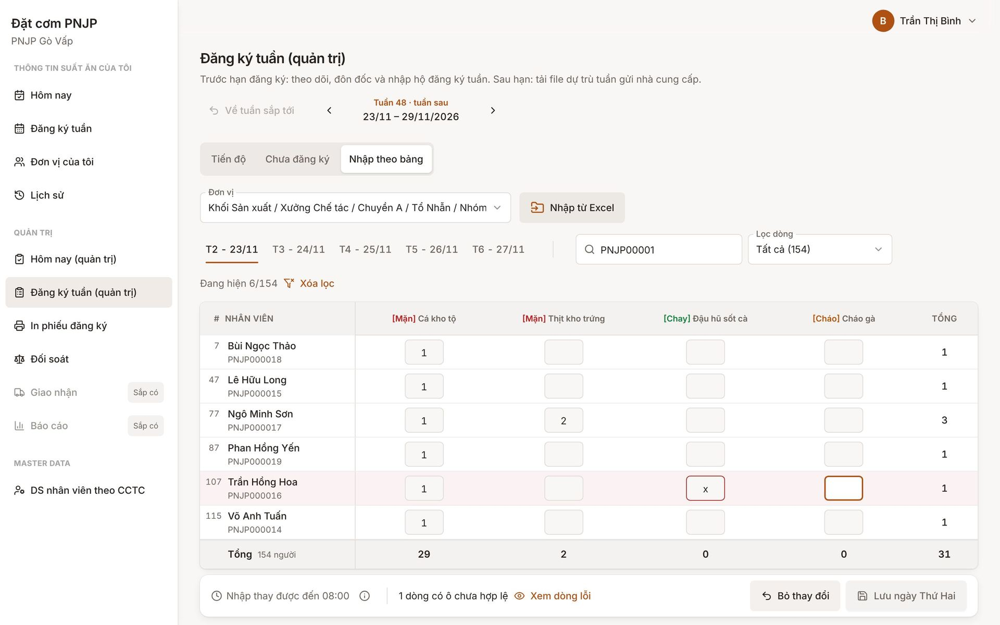

5. Cách nhanh: **Nhập từ Excel** → **Tải tệp mẫu** (đã có số hiện tại, chỉ các ngày còn sửa được) → sửa → **Kiểm tra tệp** → **Lưu n thay đổi**. Một dòng lỗi là không lưu gì.

   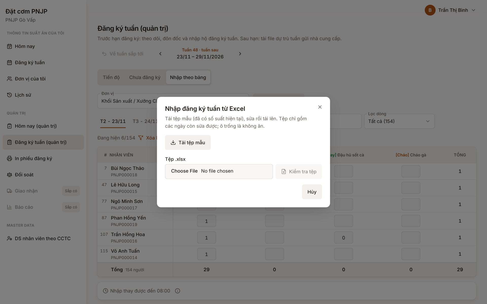

6. Tab **Tiến độ**: theo từng đầu mối – số người, đã/chưa đăng ký, số suất.

   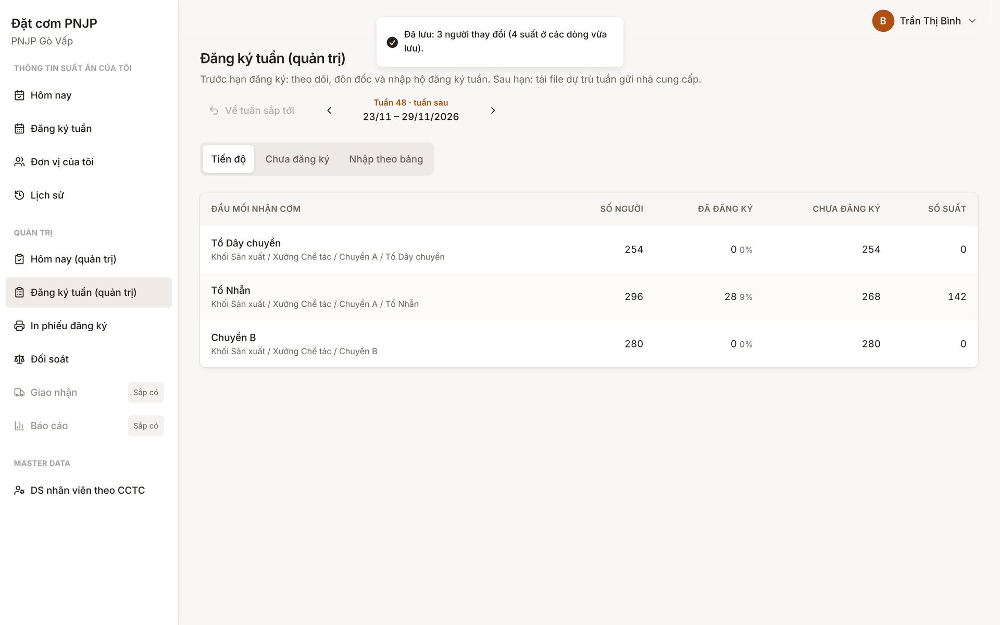

7. Tab **Chưa đăng ký**: lọc Ngày (cả tuần hoặc từng ngày) và Bộ phận → đôn đốc hoặc nhập hộ trước hạn (BR-21).

   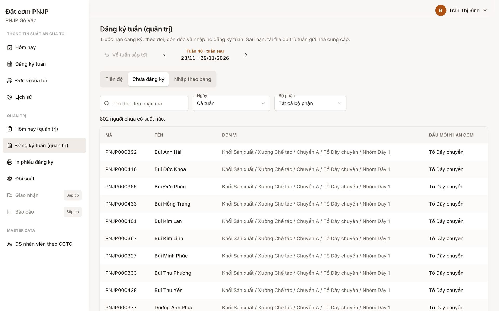

> **Chuẩn bị cho Phần C–D:** nhập **1 suất mỗi ngày thứ Hai–thứ Sáu** cho `PNJP000014`–`PNJP000040` (27 người). Cùng `PNJP000001`, ngày nào cũng có 28 người có suất, đủ để tỷ lệ có mặt trên 50% trong các kịch bản.

Quy tắc: BR-20, BR-21; bảng dùng được trên tablet từ 768 px.

### Case B7 – Đóng đăng ký, chụp dự trù, gửi file dự trù cho NCC

**Ai:** hệ thống (job `close-week`), rồi HC

1. **Giờ giả** `2026-11-19T23:59:30+07:00`: `PNJP000001` thêm một suất thứ Năm → **vẫn được** (hạn tính hết phút 23:59).

   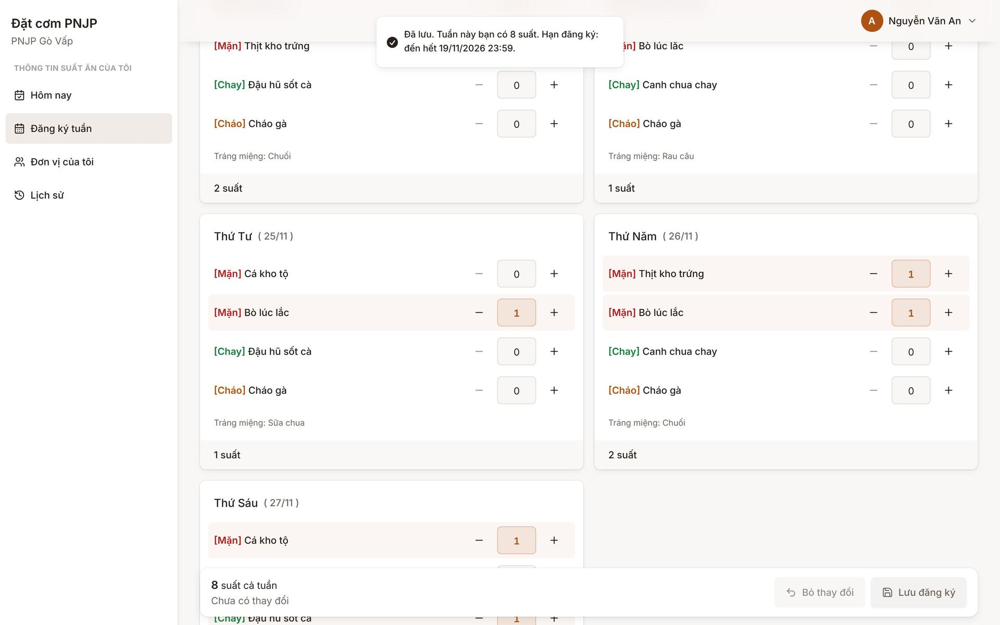

2. **Giờ giả** `2026-11-20T00:01:00+07:00`: trong 1 phút (hoặc ngay khi tải trang) dự trù được chụp. `/week` của nhân viên: chip "Đã chốt dự trù", tab **Đăng ký thực tế** mở sẵn, mỗi ngày "Sửa đến 08:00", mỗi món "Dự trù: n".

   

3. `/admin/menu`: badge "Đã chốt dự trù".

   

4. HC → `/admin/registrations` → tab **Dự trù gửi NCC** (chỉ HC thấy): "Chốt dự trù lúc 00:01", tổng theo ngày → **Tải file dự trù tuần** (mỗi ngày một sheet, dòng là đầu mối theo tầng, cột là món). Gửi NCC **ngoài hệ thống**.

   

Quy tắc: BR-03, BR-07, BR-44, BR-45. Dự trù không bao giờ đổi (database chặn UPDATE/DELETE trên `ForecastLine`).

### Case B8 – Sau hạn tuần, trước 08:00 ngày D: vẫn thêm/sửa/bỏ được

**Ai:** nhân viên · **Trang:** `/week`, `/today`

1. **Giờ giả** `2026-11-21T10:00:00+07:00`: `PNJP000001` thêm 1 Chay thứ Hai trên tab **Đăng ký thực tế** → lưu. Món đó hiện "Dự trù: 0 (+1)".

   

2. Tab **Đăng ký dự trù**: bảng chỉ đọc "Chốt 19/11/2026 23:59 · Sửa ở tab Thực tế", đúng số đã chụp.

   

3. **Giờ giả** `2026-11-23T07:59:00+07:00`: `PNJP000041` (cùng Nhóm Nhẫn 1, **không có dự trù**) vào `/today` thêm 1 Cháo → **Lưu** → "Đã lưu." Thẻ "Dự trù (lúc chốt tuần) 0 suất · Hiện tại 1 suất", "Còn 1 phút để thay đổi (đến 08:00)."

   

4. **Giờ giả** `2026-11-23T08:00:00+07:00`: nút +/− biến mất, chỉ còn số đã đặt. Nhân viên phải báo quản trị bộ phận (case C2). Thứ Ba vẫn sửa được.

   

Mọi thay đổi sau hạn tuần hiện ở Đối soát dưới dạng "Cần xem xét" (Thêm suất, Giảm suất, Đổi món, Không ăn). Quy tắc: BR-23, BR-24.

---

## 5. Phần C – Sáng ngày D: chấm công và xử lý từng người

Hai trang chính:

- **`/admin/today` – Hôm nay (quản trị)**: xử lý **từng người**. Chọn ngày, thẻ tổng (Người có suất · Đã có mặt · Tạm hủy · Thực tế · Dự trù), khung **Đồng bộ chấm công** (lần gần nhất, kết quả chốt 08:10, nghỉ phép, nút **Chạy lại đồng bộ** cho HC), tab **Tất cả** / **Cần xem xét (n)**, mỗi dòng có Suất ăn, Chấm công, Cần xem xét và nút **Xác nhận có mặt**, **Sửa suất**.
- **`/today` – Hôm nay** của nhân viên: suất của mình, khung **Chấm công**, cờ nghỉ phép, tráng miệng.

> Từ thứ Hai 23/11, `/week` mặc định mở **tuần sau**; `/today`, `/admin/today`, `/admin/reconciliation` luôn mở **hôm nay** theo giờ hệ thống. Trong ảnh, `/admin/today` thường được lọc "PNJP00001" để thấy nhóm 014–019.

### Case C1 + C3 – Trước 08:00, mọi người đúng giờ

**Kịch bản:** `forgot-to-check-in` (người ngoài 008–020 vẫn đúng giờ) · **Giờ giả:** `2026-11-23T07:30:00+07:00`

1. Nhân viên `PNJP000001` trên `/today`: "Dự trù (lúc chốt tuần) 2 suất · Hiện tại 3 suất", "Đã ghi nhận có mặt. Giờ vào: 07:45.", "Còn 30 phút để thay đổi (đến 08:00).", các món có +/−, nút **Lưu** và **Không ăn hôm nay** (hỏi "Bỏ tất cả suất ăn hôm nay?").

   

2. HC trên `/admin/today`: người đúng giờ hiện "Có mặt", "Vào 07:45"; 014–020 "Chưa chấm công". Khung đồng bộ: "Chốt chấm công lúc 08:10: chưa chạy."

   

Với kịch bản `on-time`, sau 08:10 khung đồng bộ ghi "tạm hủy suất của 0 người" (giống ảnh C9 bước 5).

### Case C2 – Quản trị sửa suất sau 08:00, thêm suất phát sinh

**Ai:** `PNJP000002` (hoặc HC) · **Giờ giả:** `2026-11-23T08:05:00+07:00`

1. `/admin/today` → tìm `PNJP000030` → **Sửa suất**: "Sau 08:00 chỉ quản trị được sửa, kèm lý do. Suất thêm mới được đánh dấu phát sinh." Tăng 1 Thịt kho trứng; chưa có lý do thì "Vui lòng nhập lý do." và nút Lưu bị khóa.

   

2. Nhập lý do → **Lưu**.

   

3. Dòng hiện 2 món và case "Thêm suất", "Phát sinh".

   

4. Người chưa có suất (nhân viên mới `PNJP000042`): `/admin/registrations` → **Tuần trước** về tuần 48 → **Nhập theo bảng** → đơn vị → tìm mã. Ngày đã khóa ghi "Đã khóa lúc 08:00: chỉ thêm suất bổ sung (có lý do)"; bấm **+** ở dòng → hộp **Thêm suất bổ sung**: Món, Số suất, **Lý do (bắt buộc)**.

   

5. Lưu → "Đã thêm suất bổ sung.", dòng có nhãn "Bổ sung".

   

Quản trị bộ phận chỉ sửa được người trong đơn vị mình (ngoài phạm vi: 403). Quy tắc: BR-24, BR-25, BR-70.

### Case C4 – Quên chấm công → tạm hủy → xác nhận có mặt

**Kịch bản:** `forgot-to-check-in` · **Ngày:** thứ Hai 23/11

1. **Giờ giả** `08:11` (chờ job ~1 phút): 7 người 014–020 thành **Tạm hủy**, suất bị gạch, thẻ "Tạm hủy 7". Khung đồng bộ: "Chốt chấm công lúc 08:11: tạm hủy suất của 7 người." Đăng ký gốc **không bị xóa**.

   

2. Tab **Cần xem xét**: họ đứng đầu với "Tạm hủy do chưa chấm công".

   

3. `PNJP000014` trên `/today`: chữ đỏ "Chưa chấm công trước 08:10: suất ăn của bạn đang tạm hủy. Nếu bạn đã đi làm, hãy báo quản lý xác nhận có mặt."

   

4. **Giờ giả** `08:15`: `PNJP000002` tìm `PNJP000014` → **Xác nhận có mặt** → "Dùng khi nhân viên quên chấm công hoặc đi trễ…", **Lý do (không bắt buộc)** → **Xác nhận có mặt**.

   

5. Dòng thành "Có mặt", "Trần Thị Bình xác nhận lúc 08:15", case "Quản trị xác nhận có mặt"; thẻ Tạm hủy còn 6.

   

6. Nhân viên thấy "Quản trị đã xác nhận bạn có mặt." (không thấy lý do).

   

Quy tắc: BR-30, BR-31, BR-33.

### Case C5 – Chấm 08:05 nhưng dữ liệu về DMP trễ

**Kịch bản:** `late-record` · **Ngày:** thứ Ba 24/11

1. `08:11`: 014–020 "Tạm hủy".

   

2. `08:21`: lần đồng bộ sau thấy giờ vào 08:05 ≤ 08:10 → **tự khôi phục**: "Có mặt", "Vào 08:05", Cần xem xét (0). Không ai phải làm gì.

   

Quy tắc: BR-32.

### Case C6 – Đi trễ 08:15

**Kịch bản:** `late` · **Ngày:** thứ Tư 25/11

1. `08:11`: 014–020 "Tạm hủy", "Vào 08:15".

   

2. `08:25`: vẫn tạm hủy – giờ vào sau 08:10 **không** tự khôi phục. Muốn giữ suất: quản lý xác nhận trên DMP (C7) hoặc quản trị **Xác nhận có mặt** (C4 bước 4).

   

### Case C7 – Quản lý xác nhận có mặt trên DMP (trước chốt)

**Kịch bản:** `manager-confirmed` · **Ngày:** thứ Năm 26/11

1. `08:11`: 014–020 "Tạm hủy".

   

2. `08:21`: `PNJP000014` (không chấm công, quản lý đã tick) được khôi phục; 015–020 còn tạm hủy.

   

3. `08:26`: 015–020 "Có mặt", "Vào 08:25", "QL xác nhận (DMP)" – giờ vào trễ không quan trọng khi có xác nhận. Case "QL xác nhận trên DMP" (để biết).

   

4. Nhân viên: "Đã ghi nhận có mặt. Giờ vào: 08:25. Quản lý đã xác nhận bạn có mặt trên DMP."

   

Quy tắc: BR-30, BR-32. Cách DMP trả trường này còn chờ đội DMP (Q32).

### Case C8 – Nghỉ phép nửa ngày

**Kịch bản:** `morning-leave` (thứ Hai 30/11) và `afternoon-leave` (thứ Ba 01/12) · Nghỉ phép đồng bộ ở phút 30 mỗi giờ, hoặc khi bấm Chạy lại đồng bộ.

1. Nghỉ sáng, `07:05`: dòng có cờ "Nghỉ sáng · Nghỉ phép nửa ngày (sáng)", case "Có đơn nghỉ nhưng vẫn có suất".

   

2. `08:11`: họ bị **Tạm hủy** vì chưa chấm công (không phải vì đơn nghỉ); vào 13:00 cũng không khôi phục.

   

3. Nhân viên: thông báo tạm hủy + "Có đơn nghỉ buổi sáng (…)".

   

4. Nghỉ chiều, `08:11`: cờ "Nghỉ chiều", chấm công 07:45 → giữ suất; không phải case cần xem xét.

   

Quy tắc: BR-35 (đơn nghỉ chỉ là cờ, không tự hủy suất); BR-41 chỉ tính nghỉ cả ngày và nghỉ sáng.

### Case C9 – DMP lỗi (cơ chế an toàn)

**Kịch bản:** `api-error` · **Ngày:** thứ Sáu 27/11

1. `07:05`: HC thấy banner đỏ "Lấy dữ liệu chấm công ngày 27/11/2026 từ DMP thất bại lúc 07:05. Hệ thống chưa hủy suất ăn nào; hãy chạy lại đồng bộ." Khung đồng bộ đỏ: "Lỗi: Simulated DMP API error". Nhân viên **không** thấy banner này.

   

2. `08:11`: banner thứ hai "chưa có dữ liệu chấm công nên chưa hủy suất nào…"; khung đồng bộ "Chốt chấm công lúc 08:11: không hủy vì chưa có dữ liệu chấm công." **Không ai bị tạm hủy.** Đồng bộ tự động sau đó, dù thành công, cũng **không tự hủy**.

   

3. `08:46` trên Đối soát: thêm banner nhắc "Ngày 27/11/2026 chưa chốt số…"; thẻ trạng thái ghi "Mốc 08:10 đang được giữ… chốt bây giờ sẽ tính tất cả suất."

   

4. Bấm **Chốt số**: hộp xác nhận nhắc lại cảnh báo đó.

   

5. Gỡ: đổi sang `on-time`, restart API, đặt giờ `08:50`, HC bấm **Chạy lại đồng bộ** → banner lỗi biến mất, "Chốt chấm công lúc 08:50: tạm hủy suất của 0 người."

   

Kịch bản `too-little-data` cho kết quả tương tự với thông báo "chỉ x/y người có suất đã chấm công (dưới ngưỡng an toàn)…" – cần hơn nửa số người có suất có mã > `PNJP000510`. Quy tắc: BR-34.

### Case C10 – Xem suất của đồng nghiệp

**Ai:** nhân viên · **Trang:** `/team`

"Đơn vị: Tổ Nhẫn · 23/11/2026 · 30/296 người có suất ăn, 33 suất." Mỗi người: tên, món, "Có ăn"/"Không ăn"; tìm theo tên hoặc mã. **Không bao giờ** hiện lý do vắng hay nghỉ phép (BR-27).


---

## 6. Phần D – Đối soát, chốt số, điều chỉnh

**Trang:** `/admin/reconciliation` (Đối soát) · **Ngày:** thứ Hai 23/11, kịch bản `forgot-to-check-in` (đã làm C2, C4).

Bố cục:

- **Thẻ trạng thái ngày**: "Chưa chốt"/"Đã chốt", nút chính (**Chốt số** hoặc **Tải file chốt số**), các mốc trong ngày (Chốt chấm công, Mở chốt số, Tự chốt, Hạn điều chỉnh) được tick khi qua, dòng **Chấm công** + **Chạy lại đồng bộ**.
- **Thẻ tổng**: trước chốt – Dự trù, Thực tế (± so với dự trù, %), Cần xem xét. Sau chốt – Dự trù, Đã chốt, Điều chỉnh, **Hiệu lực**, Cần xem xét.
- Tab **Theo món** · **Cần xem xét (n)** · **Điều chỉnh** (chỉ HC, sau chốt).

### Case D1 – Xem đối soát trước khi chốt

**Ai:** HC · **Giờ giả:** `2026-11-23T08:20:00+07:00`

1. Thẻ "Chưa chốt · Chốt số từ 08:30. Nếu chưa chốt, hệ thống tự chốt lúc 12:00.", nút **Chốt số** bị khóa. Thẻ Dự trù 29, Thực tế 27 (−2, −6,9%), Cần xem xét 11 người, 4 món vượt ngưỡng. Tab **Theo món**: nhóm theo nhà ăn, mỗi món một badge **Khớp**, **Lệch**, **Vượt ngưỡng −17,2%** (lệch > 10%, BR-42) hoặc **Không có dự trù**.

   

2. Tab **Cần xem xét**: chip lọc theo case kèm số người; dòng đỏ (khẩn) trước, xám (để biết) sau. Mỗi dòng: tên, mã, đường dẫn đơn vị, "dự trù → thực tế".

   

3. Bấm chip "Tạm hủy do chưa chấm công (6)" → chỉ còn những dòng đó.

   

4. Biểu tượng cuối dòng → mở `/admin/today?date=2026-11-23&q=MÃ` đúng người đó để xử lý. **Đối soát chỉ đếm; xử lý luôn ở trang Hôm nay.**

   

### Case D2 – Chốt số và gửi file cho NCC

**Ai:** HC · **Giờ giả:** `2026-11-23T08:30:00+07:00`

1. **Chốt số** → "Chốt số ngày 23/11/2026? Các suất đang tạm hủy sẽ bị hủy hẳn, số chốt được lưu lại và gửi nhà cung cấp. Sau khi chốt chỉ điều chỉnh được đến 10:30." → **Chốt số**.

   

2. "Đã chốt số ngày 23/11/2026: 27 suất." Badge "Đã chốt", "Đã chốt lúc 08:30 bởi Lê Hoàng Cường. Điều chỉnh được đến 10:30.", thẻ Đã chốt 27 / Hiệu lực 27; bảng thêm cột Đã chốt, Điều chỉnh, Hiệu lực.

   

3. **Tải file chốt số** (`chot-so-2026-11-23.xlsx`): sheet "Chốt số 23-11" (dòng = đầu mối theo nhà ăn và tầng, cột = món, dòng Tổng cộng = thẻ Đã chốt) và sheet "Nhãn hộp cơm" (mỗi đầu mối một nhãn). Gửi NCC **ngoài hệ thống**. Ảnh dưới dựng lại nội dung file:

   

4. Người còn tạm hủy giờ là **Vắng**: `/today` ghi "Vắng mặt: suất ăn đã bị hủy." và "Chốt lúc 08:30: bạn có 0 suất hôm nay."

   

5. **Quên chốt**: 08:45 HC thấy banner "Ngày … chưa chốt số…" (ảnh C9 bước 3). 12:00 hệ thống **tự chốt**: "Hệ thống tự chốt lúc 12:01." (ảnh: thứ Sáu 27/11; mốc ghi theo giờ job chạy).

   

Quy tắc: BR-43, BR-44, BR-45.

### Case D3 – Sau chốt, mọi sửa thông thường bị chặn

`/admin/today`: "Đã chốt số lúc 08:30 (Lê Hoàng Cường). Không sửa suất được nữa; mọi thay đổi do admin hành chánh điều chỉnh trên Đối soát." Không còn nút Sửa suất / Xác nhận có mặt; người tạm hủy hiện "Vắng", case "Đã hủy do vắng". API sửa thường, bảng nhập, suất bổ sung, nhân viên tự sửa đều trả 409 `DAY_FINALIZED`.


### Case D5 – Xác nhận DMP đến **sau** khi đã chốt

**Ai:** hệ thống ghi nhận, HC quyết định · **Giờ giả:** `2026-11-23T08:40:00+07:00`

1. Đổi `.env` sang `manager-confirmed`, restart API, đặt giờ 08:40. HC bấm **Chạy lại đồng bộ** trên Đối soát.
2. Tab Cần xem xét: 015–020 có "Đã hủy do vắng" + **"QL xác nhận trên DMP sau khi chốt"** (với `late-record` là "Chấm công về sau khi chốt"). **Số liệu không đổi** – hệ thống không tự thêm vào đơn đã chốt. HC gọi NCC; nếu đồng ý thì làm D4.

   

Quy tắc: BR-32, BR-41, BR-46.

### Case D4 – HC điều chỉnh sau chốt (trước 10:30)

**Ai:** HC · **Giờ giả:** `2026-11-23T09:00:00+07:00`

1. Tab **Điều chỉnh**: "Điều chỉnh được đến 10:30.", "Chưa có điều chỉnh nào." → **Thêm điều chỉnh**.

   

2. Chọn nhân viên (`PNJP000015`); mỗi món có +/− bắt đầu từ số hiện có. Tăng Cá kho tộ: "Hiện có 0 → 1 (+1)" và ô **Nhà cung cấp đã đồng ý** ("Bắt buộc khi thêm suất"). Chưa có lý do/tick thì **Lưu điều chỉnh** bị khóa. Giảm suất không cần tick.

   

3. Nhập **Lý do**, tick NCC → **Lưu điều chỉnh**.

   

4. "Đã lưu điều chỉnh số 1." Thẻ Điều chỉnh +1, **Hiệu lực 28**, **Đã chốt vẫn 27**. Bảng điều chỉnh: số, lúc/người tạo, nhân viên/thay đổi, lý do, tổng, NCC đồng ý, nút tải **file bổ sung**.

   

5. File bổ sung chỉ chứa ô thay đổi, có dấu:

   

6. Nhân viên trên `/today`: "Chốt lúc 08:30: bạn có 1 suất hôm nay… Đã điều chỉnh sau chốt: từ 0 thành 1 suất." (không thấy lý do).

   

Lỗi thường gặp: chưa có thay đổi, thiếu lý do, tăng mà chưa tick NCC, bớt quá số đang có. Quy tắc: BR-46.

### Case D6 – Quá 10:30

**Giờ giả:** `2026-11-23T10:31:00+07:00`. "Đã quá hạn điều chỉnh (10:30)", không còn nút Thêm điều chỉnh; đồng bộ chấm công cho ngày này dừng (API trả 409 nếu gọi).


### Case D7 – Quản trị bộ phận xem đối soát

**Ai:** `PNJP000002`. Chỉ số liệu trong phạm vi (lọc "Bộ phận"), **không có** nút Chốt số, không có tab Điều chỉnh; gọi API chốt/điều chỉnh → 403. Ngày đã qua: banner "Đang xem ngày đã qua: chỉ xem và tải lại file…". Bộ chọn ngày không cho chọn tương lai.


---

## 7. Phần E – Sau bữa trưa

Hiện chỉ có **`/history`** (Lịch sử) cho nhân viên: mỗi ngày đã qua có Dự trù, Thực tế, Sau chốt, món, tình trạng (Có ăn / Không đăng ký / Đã hủy); xem 4 tuần một lần.


Các trang sau là mục "Sắp có" trên menu, mô tả theo plan (hành trình J4):

| Case                               | Ai                            | Trang             | Sẽ làm gì                                                                          | Quy tắc      |
| ---------------------------------- | ----------------------------- | ----------------- | ---------------------------------------------------------------------------------- | ------------ |
| E1 Xác nhận giao nhận theo đầu mối | QT bộ phận (HC làm thay được) | `/admin/delivery` | Nhập số nhận, số dư, ghi chú trước 15:00; quá hạn hệ thống ghi "Nhận đủ"           | BR-50, BR-51 |
| E2 Xác nhận giao nhận cuối ngày    | HC                            | `/admin/delivery` | Kiểm tra lệch ±5% so với Hiệu lực (đỏ nếu vượt), xác nhận → khóa dữ liệu ngày      | BR-50, BR-52 |
| E3 Báo cáo                         | QT bộ phận, HC                | `/admin/reports`  | Ngày/tuần/tháng: dự trù, chốt, điều chỉnh, hiệu lực, nhận, dư, chi phí; xuất Excel | BR-53        |
| E4 Nhật ký hoạt động               | HC, QT hệ thống               | `/admin/audit`    | Lọc audit theo ngày, người, đối tượng                                              | BR-70        |

---

## 8. Phần F – Case đặc biệt về dữ liệu và phân quyền

### Case F1 – Nhân viên không có đầu mối → đầu mối nhận cơm tập trung

**Ai:** HC · **Trang:** `/admin/org`

1. Trước đó: tab **Chưa đăng ký cơm được** ghi "…: chưa đặt cơm được" cho Kho vận, Sửa chữa, Chuyền A (ảnh A4 bước 3); `PNJP000006` không đặt được (ảnh B5 bước 4).
2. Chọn **Tổ Bảo vệ** (đầu mối hợp lệ, Tầng 1) → tick **"Dùng đơn vị này làm đầu mối nhận cơm tập trung"** → "Đã lưu: Đầu mối nhận cơm tập trung." (có **Hoàn tác**). Cây hiện badge "Đầu mối tập trung".

   

3. Chọn **Kho vận**: "Hiện trạng: 51 nhân viên ở đây (gồm cấp dưới) chưa có đầu mối nhận cơm; suất cơm của họ được giao về đầu mối tập trung Tổ Bảo vệ, tại Tầng 1 · Nhà ăn Gò Vấp."

   

4. Tab **Chưa đăng ký cơm được**: lý do thành "…: vẫn đặt cơm được, nhận tại đầu mối tập trung".

   

5. `PNJP000006` giờ thấy thực đơn và đặt cơm được (ảnh: tuần 49); dự trù ghi họ ở Tổ Bảo vệ, Tầng 1.

   

- Đặt tập trung cho đầu mối thiếu tầng (Tổ Sửa chữa) bị từ chối; tick ở đơn vị khác thì chuyển đầu mối tập trung sang đó.
- Chỉ người mà phòng ban không xác định được **nhà ăn** mới thật sự không đặt được.

Quy tắc: BR-60, BR-63 (CR 2026-11-04).

### Case F2 – Nhân viên nghỉ việc

Đồng bộ hằng ngày 02:00 thấy ngày nghỉ việc trên DMP → hủy mọi suất từ ngày đó (ngày đã khóa không đụng tới). Trong bảng nhập hiện "Đã nghỉ việc". Nhân viên mới: quản trị bộ phận thêm bằng suất bổ sung (C2). DMP giả không có kịch bản nghỉ việc nên không có ảnh. Quy tắc: BR-36, BR-25.

### Case F3 – Phân quyền theo phạm vi

| Thử                                                                        | Kết quả (đã kiểm tra khi chụp ảnh) |
| -------------------------------------------------------------------------- | ---------------------------------- |
| `PNJP000002` (Xưởng Chế tác) cấp lại PIN cho `PNJP000999` (Xưởng Kim hoàn) | `403 FORBIDDEN`                    |
| `PNJP000002` gọi `POST /api/admin/reconciliation/finalize`                 | `403 FORBIDDEN`                    |
| `PNJP000005` (Xưởng Kim hoàn) xem `/admin/today`                           | Chỉ thấy người Xưởng Kim hoàn      |
| Nhân viên hoặc quản trị hệ thống mở `/admin/today`                         | Không có trên menu; API trả 403    |
| Quản trị bộ phận Chạy lại đồng bộ                                          | Không có nút; API trả 403          |

Menu chỉ ẩn nút; **API luôn kiểm tra (vai trò, hành động, phạm vi)** qua `@RequirePermission`.

---

## 9. Kịch bản trọn một tuần (chạy liền mạch)

Đây là đúng trình tự đã dùng để chụp ảnh. Mỗi dòng: giờ giả cần đặt (2.2), kịch bản DMP, ai đăng nhập, case.

| #   | Giờ giả (VN)                  | DMP                  | Ai                 | Làm gì                                                                        | Case               |
| --- | ----------------------------- | -------------------- | ------------------ | ----------------------------------------------------------------------------- | ------------------ |
| 1   | 13/11 09:00                   | `on-time`            | 001, 002, 003, 004 | Đăng nhập, đổi PIN; tạo phiên curl cho 004                                    | A1, 2.2            |
| 2   | 13/11 09:00                   |                      | 003                | Tạo 7 món chính, 3 tráng miệng                                                | A7                 |
| 3   | 16/11 13:00                   |                      | 003                | Banner chưa công bố; lập tuần 48 T2–T6, lưu nháp, công bố                     | B1                 |
| 4   | 17/11 10:00                   |                      | 001                | Tự đăng ký T2–T6 (7 suất)                                                     | B5                 |
| 5   | 17/11 10:30                   |                      | 002                | In phiếu Nhóm Nhẫn 1; nhập 1 suất/ngày cho 014–040; xem Tiến độ, Chưa đăng ký | B6                 |
| 6   | 18/11 09:00                   |                      | 003 → 001          | Đổi Gà chiên mắm → Bò lúc lắc thứ Tư; 001 thấy thông báo                      | B4                 |
| 7   | 19/11 23:59:30                |                      | 001                | Sửa thứ Năm: vẫn được                                                         | B7                 |
| 8   | 20/11 00:01                   |                      | 003                | Dự trù được chụp; tab Dự trù gửi NCC                                          | B7                 |
| 9   | 21/11 10:00                   |                      | 001                | Thêm 1 Chay thứ Hai                                                           | B8                 |
| 10  | (restart)                     | `forgot-to-check-in` | –                  | Đổi kịch bản **trước** 07:00 thứ Hai                                          | 2.3                |
| 11  | 23/11 07:30                   |                      | 001, 003           | `/today`, `/admin/today` trước khóa                                           | C1                 |
| 12  | 23/11 07:59 → 08:00           |                      | 041                | Không dự trù vẫn đăng ký; 08:00 bị khóa                                       | B8                 |
| 13  | 23/11 08:05                   |                      | 002                | Sửa suất 030 có lý do; thêm suất bổ sung cho 042                              | C2                 |
| 14  | 23/11 08:11 (+1 phút)         |                      | 003, 014           | 014–020 tạm hủy                                                               | C4                 |
| 15  | 23/11 08:15                   |                      | 002                | Xác nhận có mặt 014                                                           | C4                 |
| 16  | 23/11 08:20                   |                      | 003                | Đối soát: Theo món, Cần xem xét, mở sang Hôm nay                              | D1                 |
| 17  | 23/11 08:30                   |                      | 003, 015           | Chốt số, tải file; 015 thấy Vắng                                              | D2, D3             |
| 18  | (restart) 23/11 08:40         | `manager-confirmed`  | 003                | Chạy lại đồng bộ → "QL xác nhận trên DMP sau khi chốt"                        | D5                 |
| 19  | 23/11 09:00                   |                      | 003, 015           | Điều chỉnh +1 cho 015, tải file bổ sung                                       | D4                 |
| 20  | 23/11 10:31                   |                      | 003, 002           | Hết hạn điều chỉnh; 002 xem chỉ đọc                                           | D6, D7             |
| 21  | 23/11 10:40                   |                      | 003, 002, 001      | Công bố tuần 49 (T2, T3) và nhập suất 014–040; 001 xem `/team`                | C8 (chuẩn bị), C10 |
| 22  | (restart) 24/11 08:11 → 08:21 | `late-record`        | 003                | Tạm hủy rồi tự khôi phục                                                      | C5                 |
| 23  | (restart) 25/11 08:11 → 08:25 | `late`               | 003                | Không tự khôi phục                                                            | C6                 |
| 24  | (restart) 26/11 08:11 → 08:27 | `manager-confirmed`  | 003, 015           | Khôi phục nhờ QL xác nhận DMP                                                 | C7                 |
| 25  | (restart) 27/11 07:05 → 08:46 | `api-error`          | 003                | Banner lỗi, mốc 08:10 bị giữ, nhắc chốt                                       | C9                 |
| 26  | (restart) 27/11 08:50         | `on-time`            | 003                | Chạy lại đồng bộ, banner biến mất                                             | C9                 |
| 27  | 27/11 12:01 (+1 phút)         |                      | 003                | Hệ thống tự chốt                                                              | D2                 |
| 28  | (restart) 30/11 07:05 → 08:12 | `morning-leave`      | 003, 015           | Nghỉ sáng bị tạm hủy                                                          | C8                 |
| 29  | (restart) 01/12 08:11         | `afternoon-leave`    | 003                | Nghỉ chiều giữ suất                                                           | C8                 |
| 30  | 01/12 13:00                   |                      | 001, 003, 006      | Lịch sử; đặt đầu mối tập trung                                                | E, F1              |
| 31  | 05/12 09:30, 16/12 10:00      |                      | 003                | Công bố trễ, công bố trong tuần, tuần đã qua                                  | B2, B3             |

Ở các ngày 24–26/11 ảnh không chốt số; thực tế job 12:00 sẽ tự chốt khi giờ giả qua 12:00 của ngày đó.

---

## 10. Phụ lục

### 10.1 Ai làm gì – tóm tắt theo vai trò

| Vai trò     | Một lần                                                      | Mỗi tuần (tuần N-1)                                                                                              | Mỗi ngày D                                                                                                                              |
| ----------- | ------------------------------------------------------------ | ---------------------------------------------------------------------------------------------------------------- | --------------------------------------------------------------------------------------------------------------------------------------- |
| Nhân viên   | Đổi PIN                                                      | Đăng ký `/week` trước 23:59 T5                                                                                   | Sửa/không ăn trước 08:00 trên `/today`; chấm công trước 08:10; báo quản lý nếu quên                                                     |
| QT bộ phận  | –                                                            | In phiếu, nhập bảng/Excel, đôn đốc "Chưa đăng ký"                                                                | Sau 08:00: sửa suất có lý do, thêm suất bổ sung, xác nhận có mặt trên `/admin/today`; xem đối soát; (P5) xác nhận giao nhận trước 15:00 |
| QT HC       | Danh mục, cây tổ chức, gán QT bộ phận, cài đặt, thư viện món | Lập + công bố thực đơn (trước T2 12:00 để tránh cảnh báo); sửa thực đơn khi NCC đổi món; tải file dự trù gửi NCC | Theo dõi đồng bộ, chạy lại khi lỗi; 08:30 chốt số, gửi file; điều chỉnh đến 10:30; (P5) xác nhận giao nhận cuối ngày                    |
| QT hệ thống | Gán HC/QT hệ thống, cấu hình DMP/SSO                         | –                                                                                                                | Xem nhật ký đồng bộ                                                                                                                     |
| Hệ thống    | –                                                            | Chụp dự trù lúc đóng đăng ký; nhắc công bố                                                                       | Lấy chấm công 5 phút/lần; tạm hủy 08:10; nhắc 08:45; tự chốt 12:00                                                                      |

### 10.2 Các loại "Cần xem xét" (BR-41)

| Nhãn                              | Khi nào                                               | Cần làm                              |
| --------------------------------- | ----------------------------------------------------- | ------------------------------------ |
| Tạm hủy do chưa chấm công         | 08:10 chưa có mặt                                     | Kiểm tra, xác nhận có mặt nếu đi làm |
| Đã hủy do vắng                    | Sau chốt, người tạm hủy                               | Để biết                              |
| Không ăn                          | NV bỏ hết suất sau hạn tuần                           | Để biết                              |
| Giảm suất / Thêm suất             | NV giảm/thêm sau hạn tuần (gồm người không có dự trù) | Để biết                              |
| Đổi món                           | Món khác với dự trù                                   | Để biết                              |
| Phát sinh                         | Quản trị thêm sau 08:00                               | Để biết                              |
| Quản trị xác nhận có mặt          | BR-33                                                 | Để biết                              |
| QL xác nhận trên DMP              | BR-32, trước chốt                                     | Để biết                              |
| Có đơn nghỉ nhưng vẫn có suất     | Nghỉ cả ngày hoặc nghỉ sáng mà vẫn có suất            | Kiểm tra                             |
| QL xác nhận trên DMP sau khi chốt | Xác nhận DMP đến sau chốt                             | HC quyết định điều chỉnh             |
| Chấm công về sau khi chốt         | Dữ liệu chấm công đến sau chốt                        | HC quyết định điều chỉnh             |

### 10.3 Những điểm còn mở

Chi tiết trong `docs/open-questions.md`:

- **Q32** – DMP trả xác nhận của quản lý như thế nào (trường nào, có rút lại được không).
- **Q36** – Hiện chỉ hạn 10:30 khóa điều chỉnh; khi có giao nhận (P5) thì xác nhận giao nhận cuối ngày cũng khóa.
- **Q37** – Loại "Cần xem xét" nào thật sự cần hành động (màu đỏ/vàng/xám hiện là lựa chọn hiển thị).
- **Q15, Q16** – NCC đổi món sau 08:00 ngày D; ngày lễ quyết định sau khi đã công bố.
- **Q8** – Cách đưa PIN tạm cho công nhân không có điện thoại/email.
