# Hướng dẫn workflow hệ thống đặt cơm PNJP – từng case

Tài liệu này giải thích **ai làm gì, lúc nào, trên trang nào, và thấy gì**, đi từ bức tranh tổng thể tới từng bước nhỏ để bạn tự tái hiện được mọi case trên máy local.

- Nguồn: `docs/plan.md` (v1.4), các file `docs/demo-*.md`, và code web/API hiện tại (P0–P4 đã build; P5 Giao nhận, P6 Báo cáo và Nhật ký **chưa có**).
- Nhãn màn hình, nút, thông báo được trích từ `apps/web/src/messages/vi.ts`, nên khớp với cái bạn thấy trên giao diện.
- Mã quy tắc (BR-xx) để bạn tra lại trong `docs/plan.md` mục 2.

## Mục lục

1. [Tổng quan](#1-tổng-quan)
2. [Chuẩn bị môi trường để tái hiện](#2-chuẩn-bị-môi-trường-để-tái-hiện)
3. [Phần A – Thiết lập ban đầu (làm một lần)](#3-phần-a--thiết-lập-ban-đầu-làm-một-lần)
4. [Phần B – Tuần N-1: thực đơn và đăng ký](#4-phần-b--tuần-n-1-thực-đơn-và-đăng-ký)
5. [Phần C – Sáng ngày D: chấm công và xử lý từng người](#5-phần-c--sáng-ngày-d-chấm-công-và-xử-lý-từng-người)
6. [Phần D – Đối soát, chốt số, điều chỉnh](#6-phần-d--đối-soát-chốt-số-điều-chỉnh)
7. [Phần E – Sau bữa trưa (chưa build)](#7-phần-e--sau-bữa-trưa-chưa-build)
8. [Phần F – Case đặc biệt về dữ liệu và phân quyền](#8-phần-f--case-đặc-biệt-về-dữ-liệu-và-phân-quyền)
9. [Kịch bản trọn một tuần (chạy liền mạch)](#9-kịch-bản-trọn-một-tuần-chạy-liền-mạch)
10. [Phụ lục](#10-phụ-lục)

---

## 1. Tổng quan

### 1.1 Hệ thống làm gì

Thay quy trình giấy + Excel đặt cơm trưa ở nhà máy PNJP Gò Vấp:

1. **Phòng Hành chánh** lập thực đơn tuần và công bố.
2. **Nhân viên** (hoặc quản trị bộ phận nhập hộ cho công nhân) đăng ký suất ăn cho tuần sau. Hết **23:59 thứ Năm** hệ thống chụp lại **dự trù** (forecast) và gửi nhà cung cấp (NCC) để chuẩn bị.
3. **Sáng ngày D**: nhân viên còn sửa được đến **08:00**. Hệ thống lấy chấm công từ **DMP**; ai chưa chấm công lúc **08:10** thì suất bị **tạm hủy**. Quản lý hoặc quản trị xác nhận có mặt để khôi phục.
4. **08:30** Hành chánh **chốt số**, tải file Excel gửi NCC. Đến **10:30** còn **điều chỉnh** được (cần lý do, thêm suất phải được NCC đồng ý).
5. Sau bữa trưa: xác nhận giao nhận, báo cáo, chi phí (P5–P6, chưa build).

### 1.2 Bốn vai trò và tài khoản demo

Một người có thể giữ nhiều vai trò. **Quản trị vẫn là nhân viên**, vẫn tự đặt cơm cho mình.

| Vai trò                  | Ai ngoài đời                                 | Phạm vi                             | Tài khoản demo (PIN `123456`)                                                       |
| ------------------------ | -------------------------------------------- | ----------------------------------- | ----------------------------------------------------------------------------------- |
| Nhân viên                | Mọi nhân viên đang làm theo DMP              | Bản thân + đầu mối của mình         | `PNJP000001` Nguyễn Văn An (Nhóm Nhẫn 1, đầu mối Tổ Nhẫn)                           |
| Quản trị bộ phận         | Thư ký phòng, người giữ máy tính bảng của tổ | Các đơn vị được gán và mọi cấp dưới | `PNJP000002` Trần Thị Bình (Xưởng Chế tác); `PNJP000005` Võ Thị Em (Xưởng Kim hoàn) |
| Quản trị Hành chánh (HC) | Phòng Hành chánh                             | Toàn nhà máy                        | `PNJP000003` Lê Hoàng Cường                                                         |
| Quản trị hệ thống        | IT                                           | Toàn hệ thống                       | `PNJP000004` Phạm Minh Dũng                                                         |

Tài khoản đặc biệt: `PNJP000006` (Kho vận, chưa có đầu mối nhận cơm), `PNJP000007` (Tổ Sửa chữa, đầu mối thiếu tầng). **Mọi** nhân viên seed (`PNJP000001`…`PNJP001700`) đều có PIN ban đầu `123456` và phải đổi ở lần đăng nhập đầu.

### 1.3 Bản đồ màn hình theo vai trò

Menu bên trái có 3 nhóm. Ai không có quyền thì không thấy mục đó (API vẫn chặn riêng). "Sắp có" = mục bị làm mờ, chưa build.

| Nhóm     | Trang (route)           | Tên trên menu                                             | NV  | QT bộ phận  |  QT HC  | QT hệ thống |
| -------- | ----------------------- | --------------------------------------------------------- | :-: | :---------: | :-----: | :---------: |
| Của tôi  | `/today`                | Hôm nay                                                   |  ✓  |      ✓      |    ✓    |      ✓      |
|          | `/week`                 | Đăng ký tuần                                              |  ✓  |      ✓      |    ✓    |      ✓      |
|          | `/team`                 | Đơn vị của tôi                                            |  ✓  |      ✓      |    ✓    |      –      |
|          | `/history`              | Lịch sử                                                   |  ✓  |      ✓      |    ✓    |      ✓      |
| Quản trị | `/admin/today`          | Hôm nay (quản trị)                                        |  –  | đơn vị mình | toàn NM |      –      |
|          | `/admin/registrations`  | Đăng ký tuần (quản trị)                                   |  –  | đơn vị mình | toàn NM |      –      |
|          | `/admin/print`          | In phiếu đăng ký                                          |  –  | đơn vị mình | toàn NM |      –      |
|          | `/admin/reconciliation` | Đối soát                                                  |  –  |   chỉ xem   |    ✓    |      –      |
|          | `/admin/delivery`       | Giao nhận                                                 |  –  |   Sắp có    | Sắp có  |      –      |
|          | `/admin/reports`        | Báo cáo                                                   |  –  |   Sắp có    | Sắp có  |      –      |
|          | `/admin/audit`          | Nhật ký hoạt động                                         |  –  |      –      | Sắp có  |   Sắp có    |
|          | `/system`               | Hệ thống                                                  |  –  |      –      |    –    |      ✓      |
| Danh mục | `/admin/dishes`         | Thư viện món                                              |  –  |      –      |    ✓    |      –      |
|          | `/admin/menu`           | Thực đơn tuần                                             |  –  |      –      |    ✓    |      –      |
|          | `/admin/master`         | Nhà ăn, tầng, trung tâm chi phí                           |  –  |      –      |    ✓    |      ✓      |
|          | `/admin/org`            | Vị trí địa lý nhận cơm (tiêu đề trang: "Đơn vị nhận cơm") |  –  |      –      |    ✓    |      ✓      |
|          | `/admin/employees`      | DS nhân viên theo CCTC (tiêu đề trang: "Nhân viên")       |  –  | đơn vị mình |    ✓    |      ✓      |
|          | `/admin/settings`       | Cài đặt                                                   |  –  |      –      |    ✓    |      ✓      |

Phía trên mọi trang có **vùng thông báo** (banner): thực đơn chưa công bố, đồng bộ chấm công lỗi, ngày chưa chốt số, thông báo đổi món cho nhân viên.

### 1.4 Dòng thời gian một tuần phục vụ

Gọi **tuần N** là tuần được phục vụ cơm (bắt đầu thứ Hai). Mọi mốc giờ là giờ Việt Nam và đọc từ **Cài đặt** (không cố định trong code).

```mermaid
flowchart LR
  subgraph TRUOC["Trước tuần N (một lần mỗi tuần)"]
    A["Từ T6 tuần N-2<br/>HC lập thực đơn tuần N"] --> B["HC công bố<br/>→ mở đăng ký"]
    B --> C["NV đăng ký / QT bộ phận nhập hộ<br/>sửa tự do"]
    C --> D["Hết 23:59 T5 tuần N-1<br/>chụp DỰ TRÙ<br/>HC tải file dự trù gửi NCC"]
  end
  subgraph NGAYD["Mỗi ngày phục vụ D của tuần N"]
    E["Đến 08:00<br/>NV còn tự thêm/sửa/bỏ"] --> F["07:00–08:30<br/>lấy chấm công DMP mỗi 5 phút"]
    F --> G["08:10<br/>chưa chấm công → TẠM HỦY"]
    G --> H["08:10–08:30<br/>xác nhận có mặt, sửa suất có lý do"]
    H --> I["08:30 HC CHỐT SỐ<br/>tải file gửi NCC<br/>(12:00 hệ thống tự chốt)"]
    I --> J["Đến 10:30<br/>HC ĐIỀU CHỈNH sau chốt"]
    J --> K["Trưa: giao nhận<br/>15:00 hạn xác nhận (P5)"]
  end
  D --> E
```



| Mốc                          | Mặc định                   | Ai bị ảnh hưởng | Điều gì xảy ra                                      | Quy tắc      |
| ---------------------------- | -------------------------- | --------------- | --------------------------------------------------- | ------------ |
| Thứ Sáu tuần N-2, 00:00      | –                          | HC              | Bắt đầu lập được thực đơn tuần N                    | BR-01        |
| Thứ Hai tuần N-1, 12:00      | `menu.publishWarnAt`       | HC              | Nếu tuần N chưa công bố: banner vàng trên mọi trang | BR-06        |
| Hết thứ Năm tuần N-1 (23:59) | `registration.close`       | Tất cả          | Đóng đăng ký dự trù, chụp **dự trù** bất biến       | BR-03, BR-07 |
| Ngày D 07:00                 | `attendance.pollStart`     | Hệ thống        | Bắt đầu lấy chấm công mỗi 5 phút                    | BR-30        |
| Ngày D 08:00                 | `day.lockTime`             | Nhân viên       | Khóa: NV không tự sửa được ngày D nữa               | BR-24        |
| Ngày D 08:10                 | `attendance.cutoff`        | Hệ thống        | Ai có suất mà chưa có mặt → **Tạm hủy**             | BR-31        |
| Ngày D 08:30                 | `close.time`               | HC              | Mở nút **Chốt số**                                  | BR-43        |
| Ngày D 08:45                 | `close.reminderAt`         | HC              | Banner nhắc nếu chưa chốt                           | BR-43        |
| Ngày D 10:30                 | `close.adjustmentDeadline` | HC              | Hết điều chỉnh sau chốt, ngừng đồng bộ chấm công    | BR-46, BR-32 |
| Ngày D 12:00                 | `close.autoFinalizeAt`     | Hệ thống        | Tự chốt nếu HC chưa chốt                            | BR-43        |
| Ngày D 15:00                 | `delivery.confirmDeadline` | QT bộ phận      | Hạn xác nhận giao nhận (P5, chưa build)             | BR-51        |

### 1.5 Các con số và trạng thái cần phân biệt

**Con số suất ăn**

| Tên trên màn hình | Nghĩa                                                                                 | Khi nào có                |
| ----------------- | ------------------------------------------------------------------------------------- | ------------------------- |
| **Dự trù**        | Ảnh chụp đăng ký lúc đóng đăng ký tuần. Không bao giờ đổi.                            | Từ 23:59 thứ Năm tuần N-1 |
| **Thực tế**       | Đăng ký hiện tại, trừ suất của người bị tạm hủy/vắng. Thay đổi liên tục đến khi chốt. | Đến lúc chốt số           |
| **Đã chốt**       | Ảnh chụp lúc chốt số, gửi NCC. Không bao giờ đổi.                                     | Từ lúc chốt số            |
| **Điều chỉnh**    | Tổng các dòng điều chỉnh sau chốt (+/−).                                              | Sau chốt, trước 10:30     |
| **Hiệu lực**      | Đã chốt + Điều chỉnh. Dùng cho giao nhận, chi phí, báo cáo.                           | Sau chốt                  |

**Trạng thái tuần thực đơn** (`/admin/menu`): Chưa tạo → Bản nháp → Đã công bố → Đã chốt dự trù.

**Cửa sổ sửa của một ngày** (nhìn từ phía nhân viên): trước hạn tuần (sửa tự do) → sau hạn tuần, trước 08:00 ngày D ("Sửa đến 08:00", mọi thay đổi so với dự trù đều hiện ra) → "Đã khóa" (chỉ quản trị sửa, có lý do) → Đã chốt số (chỉ HC điều chỉnh).

**Chấm công của một người trong ngày D**: Chưa chấm công → Có mặt / Tạm hủy (08:10) → Vắng (khi chốt số, tạm hủy thành hủy hẳn).

---

## 2. Chuẩn bị môi trường để tái hiện

### 2.1 Khởi động

Cần Node ≥ 22.12, pnpm 9, JDK 25. Chạy từ thư mục gốc repo:

```bash
pnpm install
```

```bash
cp .env.example .env
```

Terminal 1 (giữ chạy):

```bash
pnpm db:local
```

Terminal 2:

```bash
pnpm db:seed
```

```bash
pnpm dev
```

Mở http://localhost:3000. `.env` mặc định đã bật: `CLOCK_FAKE_ENABLED=true` (giờ giả), `DMP_MODE=mock` (DMP giả), `ENTRA_MODE=mock` (SSO giả).

> **Seed có gì, không có gì:** 1 nhà máy, 1 nhà ăn (Nhà ăn Gò Vấp), 4 tầng, 10 trung tâm chi phí, cây tổ chức 6 cấp, 1.700 nhân viên, 4 loại món (Mặn, Chay, Cháo, Eat clean). **Không có món ăn, thực đơn, đăng ký nào**: phải làm Case A7 và B1 trước khi đặt cơm.

### 2.2 Điều khiển giờ giả

Giao diện **không** có nút đổi giờ; dùng API với phiên của quản trị hệ thống. Lưu ý quan trọng:

- Giờ giả **đứng yên** (không tự chạy). Muốn qua 08:10 thì phải tự đặt lại giờ.
- Giờ giả **mất khi restart** `pnpm dev`: sau mỗi lần restart phải đặt lại.
- Các job nền (lấy chấm công, chốt tuần, tự chốt…) chạy **mỗi phút theo giờ thật** nhưng dùng giờ giả. Sau khi đổi giờ, chờ tối đa 1 phút, hoặc bấm "Chạy lại đồng bộ" (HC) / tải lại trang.
- Nhảy giờ xa có thể làm phiên đăng nhập hết hạn: nếu bị đẩy về `/login` hoặc curl trả 401, đăng nhập lại.

Đầu tiên đăng nhập `PNJP000004` trên web một lần để đổi PIN (ví dụ thành `246810`). Sau đó, trong một terminal riêng, lưu phiên vào file `.clock-jar`:

```bash
curl -s -c .clock-jar -H 'content-type: application/json' -d '{"employeeCode":"PNJP000004","pin":"246810"}' localhost:3001/api/auth/pin/login
```

Đặt giờ (thay thời điểm theo case):

```bash
curl -s -b .clock-jar -X PUT localhost:3001/api/dev/clock -H 'content-type: application/json' -d '{"at":"2026-11-23T08:10:00+07:00"}'
```

Xem giờ hệ thống đang dùng:

```bash
curl -s -b .clock-jar localhost:3001/api/dev/clock
```

Về giờ thật:

```bash
curl -s -b .clock-jar -X PUT localhost:3001/api/dev/clock -H 'content-type: application/json' -d '{"at":null}'
```

### 2.3 Đổi kịch bản DMP giả

Sửa `DMP_MOCK_SCENARIO` trong `.env`, rồi restart `pnpm dev` (và **đặt lại giờ giả**). Kịch bản chỉ tác động lên nhân viên `PNJP000008`–`PNJP000020`; mọi người khác chấm công lúc 07:45.

| Kịch bản             | DMP trả về                                                            | Dùng cho case |
| -------------------- | --------------------------------------------------------------------- | ------------- |
| `on-time`            | Mọi người vào 07:45                                                   | C3            |
| `forgot-to-check-in` | 008–020 không có dòng chấm công                                       | C4, D1–D6     |
| `late-record`        | 008–020 vào 08:05 nhưng dữ liệu về DMP lúc 08:20                      | C5            |
| `late`               | 008–020 vào 08:15                                                     | C6            |
| `manager-confirmed`  | 008–014 không chấm công, 015–020 vào 08:25; quản lý xác nhận trên DMP | C7, D5        |
| `morning-leave`      | 008–020 nghỉ sáng, vào 13:00                                          | C8            |
| `afternoon-leave`    | 008–020 nghỉ chiều, vào 07:45                                         | C8            |
| `api-error`          | Mọi lần gọi đều lỗi                                                   | C9            |
| `too-little-data`    | Chỉ 30% nhân viên đầu (đến khoảng `PNJP000510`) có dòng               | C9            |

> **Bẫy cần biết:** `PNJP000008`–`PNJP000013` thuộc **Chuyền A**, nơi chưa có đầu mối nhận cơm, nên **không đặt cơm được** qua giao diện (trừ khi bạn đặt đầu mối nhận cơm tập trung, case F1). Để tái hiện các case chấm công, hãy dùng **`PNJP000014`–`PNJP000020`** (thuộc Nhóm Nhẫn 1, đầu mối Tổ Nhẫn) làm "người bị ảnh hưởng", và `PNJP000001`, `PNJP000021`–`PNJP000040` làm "người đi làm bình thường".

### 2.4 Lịch mẫu dùng trong tài liệu

Mọi ví dụ dùng **tuần N = tuần 48, thứ Hai 23/11/2026 – Chủ nhật 29/11/2026**:

| Thời điểm           | Ý nghĩa                                         |
| ------------------- | ----------------------------------------------- |
| Thứ Sáu 13/11 00:00 | Bắt đầu lập được thực đơn tuần 48               |
| Thứ Hai 16/11 12:00 | Bắt đầu cảnh báo nếu chưa công bố               |
| Thứ Năm 19/11 23:59 | Hạn đăng ký dự trù (lưu là 00:00 thứ Sáu 20/11) |
| Thứ Hai 23/11       | Ngày D đầu tiên                                 |

Mẫu giờ giả (ISO, giờ VN): `2026-11-17T10:00:00+07:00`.

---

## 3. Phần A – Thiết lập ban đầu (làm một lần)

Thứ tự đề xuất: A1 → A2 → A3 → A4 → A5 → A6 → A7. Trên thực tế phần lớn đã có sẵn trong seed; bạn chỉ cần **A1** (đăng nhập, đổi PIN) và **A7** (tạo món) để chạy được các phần sau.

### Case A1 – Đăng nhập lần đầu, đổi PIN, SSO, khóa tài khoản

**Ai:** mọi người. **Trang:** `/login`, `/change-pin`, `/auth/not-linked`.

1. Mở `/login`. Trang có nút **"Đăng nhập bằng SSO"** và form **Mã nhân viên** + **Mã PIN (6 chữ số)**.
2. Nhập `PNJP000001` / `123456` → **Đăng nhập**.
3. Bị chuyển sang `/change-pin` với lời nhắc "Đây là lần đăng nhập đầu tiên…". Nhập PIN mới 2 lần → **Đổi mã PIN**.
4. Vào trang chủ, menu chỉ có nhóm "Của tôi". Lặp lại với `PNJP000002`, `000003`, `000004` để thấy menu khác nhau theo vai trò (bảng 1.3).

Biến thể:

- **SSO (giả):** bấm "Đăng nhập bằng SSO", gõ email `an.nguyen@pnjp.test` → đăng nhập thành `PNJP000001`. Gõ email không khớp nhân viên nào → trang "Tài khoản chưa được liên kết".
- **Nhập sai PIN 5 lần** → "Tài khoản tạm khóa do nhập sai nhiều lần. Thử lại sau …" (15 phút, theo Cài đặt).
- **Quên PIN:** quản trị cấp lại ở `/admin/employees` (case A5). Nhân viên đăng nhập bằng PIN tạm và bị buộc đổi PIN.

### Case A2 – Quản trị hệ thống gán vai trò, xem nhật ký đồng bộ

**Ai:** `PNJP000004`. **Trang:** `/system`.

1. Phần "Quản trị Hành chánh và quản trị hệ thống": tìm nhân viên, chọn vai trò → **Gán vai trò**. **Thu hồi** hỏi xác nhận.
2. Phần "Nhật ký đồng bộ": các lần đồng bộ Tổ chức và nhân viên / Chấm công / Nghỉ phép, trạng thái, số bản ghi, lỗi.

> Quản trị **bộ phận** không gán ở đây mà ở `/admin/org` (case A4).

### Case A3 – Danh mục nhà ăn, tầng, trung tâm chi phí

**Ai:** HC (`PNJP000003`) hoặc quản trị hệ thống. **Trang:** `/admin/master`.

1. Ba tab: **Nhà ăn**, **Tầng**, **Trung tâm chi phí**.
2. Thêm, sửa, **ngưng dùng** (không bao giờ xóa). Cột "Số đơn vị đang gán" cho biết mục nào đang được dùng.
3. Thử ngưng dùng **Tầng 1** (đang được gán): bị từ chối.

Quy tắc: BR-62.

### Case A4 – Thiết lập đơn vị nhận cơm trên cây tổ chức

**Ai:** HC. **Trang:** `/admin/org` (menu "Vị trí địa lý nhận cơm").

Khái niệm: **đầu mối nhận cơm** = một nút trên cây tổ chức nhận chung một thùng cơm. Nhân viên thuộc đầu mối gần nhất phía trên mình. Tầng và nhà ăn lấy theo đầu mối; trung tâm chi phí lấy theo từng nhân viên (kế thừa từ cây).

1. Tab **Cây tổ chức**: chọn nút **Tổ Nhẫn**. Dòng "Hiện trạng" ghi "Đầu mối của … nhân viên, nhận cơm tại Tầng 2 · Nhà ăn Gò Vấp".
2. Câu hỏi "Đơn vị này có là đầu mối nhận cơm không?" → **Có/Không**. Đổi là thấy ngay hiện trạng thay đổi.
3. Chọn tầng, nhà ăn, trung tâm chi phí. Ô trống hiện "Kế thừa: … (từ …)".
4. Phần **Quản trị bộ phận**: gõ tên để gán quản trị cho nút này. Gán ở cấp trên thì áp cho mọi cấp dưới (Tổ Nhẫn hiện Trần Thị Bình "Quản lý từ cấp trên (từ Xưởng Chế tác)").
5. "Cách xem" → **Chỉ xem đầu mối nhận cơm**: danh sách đầu mối, số người, tình trạng (Tổ Sửa chữa "Thiếu tầng").
6. Tab **Chưa đăng ký cơm được**: nhân viên không có đầu mối hợp lệ (Kho vận, Sửa chữa, Chuyền A…).
7. Tab **Thiếu trung tâm chi phí**.
8. Tab **Nhập / xuất Excel**: **Tải xuống** mapping hiện tại → sửa → **Kiểm tra tệp**. Một dòng sai là **cả tệp bị từ chối**, có bảng lỗi theo dòng. Tệp đúng thì xem trước rồi **Áp dụng tất cả**.

Quy tắc: BR-60 đến BR-64. Mọi thay đổi được ghi audit, không sửa dữ liệu dự trù/chốt đã chụp.

### Case A5 – Tra cứu nhân viên, đổi tầng nhận cơm, cấp lại PIN

**Ai:** HC, quản trị hệ thống (toàn nhà máy); quản trị bộ phận (chỉ đơn vị mình). **Trang:** `/admin/employees`.

1. Lọc theo Khối / Phòng-Xưởng, tầng, nhà ăn, trung tâm chi phí, "Tình trạng suất ăn" (Hợp lệ / Chưa có đầu mối nhận cơm / Đầu mối thiếu tầng/nhà ăn).
2. Nút "…" trên một dòng:
   - **Cấp lại PIN** → xác nhận → hộp thoại hiện **PIN tạm một lần duy nhất**. Ghi lại, đưa cho nhân viên.
   - **Đổi tầng nhận cơm** (HC): chọn tầng + lý do bắt buộc. Cột Tầng hiện "Tầng 1 · nhận riêng". Áp dụng từ lần chụp dự trù kế tiếp.
3. Đăng nhập `PNJP000002`: chỉ thấy nhân viên Xưởng Chế tác.

### Case A6 – Cài đặt mốc giờ và ngưỡng

**Ai:** HC, quản trị hệ thống. **Trang:** `/admin/settings`.

1. Các nhóm: Đăng ký, Ngày phục vụ, Chấm công, Chốt số và giao nhận, Mã PIN; cùng "Nhà cung cấp suất ăn" (tên, đơn giá).
2. Sửa một giá trị (ví dụ "Giờ khóa thay đổi trong ngày" → `0730` tự thành `07:30`): dòng được tô, thanh dưới hiện **Lưu thay đổi (1)** / **Hủy thay đổi**.
3. Giá trị sai bị từ chối tại dòng. Mọi thay đổi được audit.

> Khi tái hiện, **giữ mặc định** để khớp với tài liệu này.

### Case A7 – Thư viện món

**Ai:** HC. **Trang:** `/admin/dishes`. Mỗi nhà ăn có thư viện riêng (chọn ở ô "Nhà ăn").

1. Tab **Loại món**: đã có Mặn (2–3 món/ngày), Chay (1), Cháo (1), Eat clean (không kiểm tra). Có thể **Thêm loại món** (mã, tên, màu, số món tối thiểu/tối đa mỗi ngày).
2. Tab **Món chính** → **Thêm món chính**: tên + loại. Tên hiển thị dạng "[Mặn] Cá kho tộ" (BR-12). Tạo tối thiểu: 1 Chay, 1 Cháo, 3 Mặn. Ví dụ: Chay "Đậu hũ sốt cà", Cháo "Cháo gà", Mặn "Cá kho tộ", "Thịt kho trứng", "Gà chiên mắm".
3. Tab **Tráng miệng** → **Thêm món tráng miệng**: ví dụ "Chuối", "Rau câu".
4. Thử thêm trùng tên (khác hoa thường/khoảng trắng): "Món này đã có trong thư viện của nhà ăn."
5. **Lưu trữ** một món: biến mất khỏi danh sách và thực đơn nhưng không bị xóa; bật "Hiện cả món đã lưu trữ" để khôi phục.
6. Nhanh hơn: **Nhập từ Excel** → **Tải tệp mẫu** → điền → **Kiểm tra tệp** → **Thêm n món**.

Quy tắc: BR-10, BR-12.

---

## 4. Phần B – Tuần N-1: thực đơn và đăng ký

### Case B1 – HC lập và công bố thực đơn đúng hạn (hành trình J5)

**Ai:** HC. **Khi nào:** thứ Hai 16/11 13:00 (đặt giờ giả `2026-11-16T13:00:00+07:00`). **Trang:** `/admin/menu`.

1. Đăng nhập `PNJP000003`. Trên đầu mọi trang có banner vàng: "Thực đơn tuần bắt đầu 23/11/2026 của Nhà ăn Gò Vấp chưa được công bố. Nhân viên chưa thể đăng ký." (BR-06, vì đã qua 12:00 thứ Hai).
2. Vào **Thực đơn tuần**. Chọn nhà ăn; tuần sắp tới (Tuần 48) đã được chọn sẵn, trạng thái "Chưa tạo". Dòng "Nếu công bố bây giờ, hạn đăng ký là đến hết 19/11/2026 23:59."
3. Bên trái là thư viện, bên phải là lưới thứ Hai–Chủ nhật. **Kéo** món chính và tráng miệng vào từng ngày thứ Hai–thứ Sáu. Thả đè lên món có sẵn = đổi món. (Màn hình < 1024 px: bấm **Thêm món** trên từng ngày.)
4. Ngày có cơ cấu lạ (ví dụ 2 món Chay) hiện ghi chú vàng "Cơ cấu khác thường lệ…" – chỉ cảnh báo, không chặn (BR-13).
5. Thứ Bảy/Chủ nhật mặc định "Không phục vụ"; **Bật phục vụ** nếu cần. Ngày lễ: **Tắt** (BR-08).
6. **Lưu nháp** (trạng thái "Bản nháp"). Nhân viên lúc này **chưa thấy** gì.
7. **Công bố** → hộp xác nhận nhắc lại hạn → xác nhận. Trạng thái "Đã công bố", banner vàng biến mất.
   - Nếu một ngày phục vụ thiếu món chính hoặc tráng miệng: nút Công bố bị khóa, liệt kê "Thứ …: thiếu …".

Quy tắc: BR-01 đến BR-03, BR-08, BR-11 đến BR-15.

### Case B2 – Công bố trễ (sau hạn thường lệ, trước thứ Hai tuần N)

**Ai:** HC. **Khi nào:** thứ Bảy 21/11 09:30, tuần 48 chưa công bố.

1. `/admin/menu`, tuần 48: badge "Công bố trễ: tự chọn hạn đăng ký" và ô **"Hạn đăng ký dự trù (đến hết)"**, gợi ý sẵn = giờ công bố + 24 giờ (Chủ nhật 09:29), không cho vượt quá Chủ nhật 23:59.
2. Sửa thành thứ Bảy 16:59 → Công bố. Header ghi "Hạn đăng ký: đến hết … 16:59".
3. Lúc 17:00 dự trù được chụp như thường.

Quy tắc: BR-04, BR-05.

### Case B3 – Công bố ngay trong tuần phục vụ (không có dự trù)

**Ai:** HC. **Khi nào:** thứ Tư 25/11 10:00, tuần 48 chưa công bố.

1. `/admin/menu` mặc định mở **tuần sau** (tuần 49); bấm **Tuần trước** để về tuần 48. Header ghi "Công bố trong tuần phục vụ: không có dự trù, mọi suất đăng ký đều tính là đăng ký thực tế." Công bố.
2. Tuần hiện "Đã công bố · không dự trù". Nhân viên vào `/week`: thứ Hai–thứ Tư đã khóa, thứ Năm–thứ Sáu còn sửa đến 08:00 mỗi ngày.
3. Tuần đã qua hết (mọi ngày phục vụ đã khóa): "Tuần đã qua…", không có nút Công bố, chỉ Lưu nháp.

Quy tắc: BR-04.

### Case B4 – Sửa thực đơn đã công bố (NCC đổi món)

**Ai:** HC thao tác; nhân viên nhận thông báo. **Trang:** `/admin/menu`, banner của nhân viên, `/week`.

1. Có nhân viên đã đăng ký một món (làm B5 trước).
2. HC kéo món khác thả đè lên món đó (**đổi món**), hoặc **bỏ món**; nhập lý do (ví dụ "Nhà cung cấp đổi món") → **Lưu thay đổi**.
3. Thông báo: "Đã lưu. x suất được chuyển sang món mới, y suất cần chọn lại, z nhân viên được thông báo."
4. Phía nhân viên (`PNJP000001`), trên đầu trang:
   - Đổi món: "Thực đơn ngày …: món A được đổi thành B. Suất bạn đã đăng ký đã chuyển sang món mới."
   - Bỏ món: "… món A đã bị bỏ. Vui lòng chọn lại món trước 08:00 ngày đó." + nút **Chọn lại món**. Nhiều thông báo gộp thành "Bạn có n thông báo mới…" → **Xem chi tiết** / **Đã xem tất cả**.
5. Nếu không chọn lại trước 08:00 ngày đó, suất bị hủy tự động (có audit).
6. Nếu đổi món **sau** hạn đăng ký: trên `/week` món mới hiện chữ đỏ "Đã đổi món: bạn đăng ký …, nhà ăn thay bằng món này."
7. Ngày đã qua 08:00 thì bị khóa, không sửa thực đơn được.

Quy tắc: BR-14.

### Case B5 – Nhân viên văn phòng tự đăng ký tuần (hành trình J1)

**Ai:** `PNJP000001`. **Khi nào:** thứ Ba 17/11 10:00. **Trang:** `/week`.

1. Vào **Đăng ký tuần**. Tuần 48 được chọn sẵn, thấy "Nhà ăn Gò Vấp", banner "Hạn đăng ký: đến hết 19/11/2026 23:59", mỗi ngày một thẻ với các món và tráng miệng.
2. Mỗi món có nút **− / +** từ 0, **không giới hạn** (3 suất cùng món, hay Chay + Cháo + Mặn cùng ngày đều hợp lệ – BR-20).
3. **Lưu đăng ký** → "Đã lưu. Tuần này bạn có n suất. Hạn đăng ký: đến hết …".
4. Sửa lại thoải mái trước hạn (BR-22). Chuyển tuần khi chưa lưu → hỏi bỏ thay đổi.

Biến thể:

- Tuần chưa công bố: "Thực đơn tuần này của Nhà ăn Gò Vấp chưa được công bố."
- `PNJP000006` (Kho vận): "Phòng ban của bạn chưa được thiết lập nhà ăn…" hoặc đặt được nếu có đầu mối tập trung (case F1).
- Đăng ký cho riêng một ngày cũng làm được ở `/today` (trước 08:00 của ngày đó).

### Case B6 – Công nhân đăng ký bằng phiếu giấy (hành trình J2)

**Ai:** quản trị bộ phận `PNJP000002`. **Khi nào:** thứ Ba–thứ Năm 17–19/11. **Trang:** `/admin/print`, `/admin/registrations`.

1. **In phiếu đăng ký** (`/admin/print`): chọn tuần 48 và đơn vị "… / Tổ Nhẫn / Nhóm Nhẫn 1" → **In phiếu**. Mỗi ngày một trang: dòng là nhân viên, cột là món, ô trống để ghi số, dòng ký "Người tổng hợp". Công nhân ghi tay, nộp lại trước 23:59 thứ Năm.
2. **Đăng ký tuần (quản trị)** → tab **Nhập theo bảng**: chọn cùng đơn vị. Bảng giống hệt phiếu in: tab theo ngày, dòng nhân viên, cột món.
   - Gõ số; **Enter** xuống dòng, **Tab** sang phải. Ô sai (`x`, `1,5`, `-1`) làm dòng đỏ "Số suất phải là số nguyên từ 0" và khóa nút lưu.
   - Lọc dòng: Tất cả / Chưa có suất / Đã sửa, chưa lưu / Có lỗi; tìm theo tên hoặc mã.
   - **Lưu ngày Thứ Hai** → "Đã lưu: n người thay đổi…". Lặp cho từng ngày.
   - Cách nhanh: **Nhập từ Excel** → **Tải tệp mẫu** (đã có số hiện tại) → sửa → **Kiểm tra tệp** → **Lưu n thay đổi**. Một dòng lỗi là không lưu gì.
3. Tab **Tiến độ**: số người đã/chưa đăng ký, số suất, % theo từng đầu mối.
4. Tab **Chưa đăng ký**: lọc Khối / Phòng-Xưởng, cả tuần hoặc từng ngày → đôn đốc hoặc nhập hộ trước hạn (BR-21).

> **Để chuẩn bị cho Phần C–D**, ở bước 2 hãy nhập **1 suất mỗi ngày thứ Hai–thứ Sáu** cho `PNJP000001` và `PNJP000014`–`PNJP000040` (28 người). Đủ để tỷ lệ có mặt luôn trên 50% trong các kịch bản.

Quy tắc: BR-20, BR-21; giao diện tablet từ 768 px.

### Case B7 – Đóng đăng ký, chụp dự trù, gửi file dự trù cho NCC

**Ai:** hệ thống (job `close-week`) rồi HC. **Khi nào:** thứ Năm 19/11 23:59:30 → thứ Sáu 20/11 00:01.

1. Đặt giờ `2026-11-19T23:59:30+07:00`. `PNJP000001` sửa một ngày: **vẫn được** (hạn tính hết phút 23:59).
2. Đặt giờ `2026-11-20T00:01:00+07:00`. Trong vòng 1 phút (hoặc ngay khi tải trang) dự trù được chụp: thực đơn thành "Đã chốt dự trù".
3. HC → `/admin/registrations` → tab **Dự trù gửi NCC** (chỉ HC thấy): "Chốt dự trù lúc …", bảng theo ngày → **Tải file dự trù tuần** (mỗi ngày một sheet, dòng là đầu mối theo tầng, cột là món). Gửi NCC **ngoài hệ thống** (email…).

Quy tắc: BR-03, BR-07, BR-44, BR-45. Dự trù **không bao giờ đổi** (database chặn UPDATE/DELETE).

### Case B8 – Sau hạn tuần, trước 08:00 ngày D: vẫn thêm/sửa/bỏ được

**Ai:** nhân viên. **Khi nào:** thứ Bảy 21/11 → thứ Hai 23/11 07:59. **Trang:** `/week`, `/today`.

1. `PNJP000001` mở `/week`: có 2 tab, **Đăng ký thực tế** mở sẵn và **Đăng ký dự trù** (bảng chỉ đọc, đúng số đã chụp). Mỗi món ghi "Dự trù: n"; mỗi ngày ghi "Sửa đến 08:00 …".
2. Thêm 1 suất Chay cho thứ Hai → lưu. Ngày đó hiện badge **Khác dự trù** và chênh "(+1)".
3. Một người **không có dự trù** (ví dụ `PNJP000041`, cùng Nhóm Nhẫn 1): đặt giờ `2026-11-23T07:59:00+07:00`, vào `/today`, đăng ký 1 suất → được chấp nhận. Trang đếm ngược "Còn 1 phút để thay đổi (đến 08:00)."
4. Đặt giờ `2026-11-23T08:00:00+07:00`: nút +/− biến mất; "Đã qua 08:00: bạn không thể tự thay đổi nữa. Nếu cần, vui lòng báo quản trị bộ phận…". Thứ Ba vẫn sửa được.

Mọi thay đổi sau hạn tuần đều hiện ở Đối soát dưới dạng "Cần xem xét" (Thêm suất, Giảm suất, Đổi món, Không ăn).

Quy tắc: BR-23, BR-24.

---

## 5. Phần C – Sáng ngày D: chấm công và xử lý từng người

**Bối cảnh chung:** đã làm B6 (28 người có 1 suất/ngày). Hai trang dùng chính:

- **`/admin/today` – Hôm nay (quản trị)**: xử lý **từng người**. Có ô chọn ngày, tìm kiếm, thẻ tổng (Người có suất · Đã có mặt · Tạm hủy · Thực tế · Dự trù), khung **Đồng bộ chấm công** (lần gần nhất, kết quả chốt 08:10, nút **Chạy lại đồng bộ** cho HC), tab **Tất cả** / **Cần xem xét (n)**, mỗi dòng có cột Suất ăn, Chấm công, Cần xem xét và nút **Xác nhận có mặt**, **Sửa suất**.
- **`/today` – Hôm nay** (nhân viên): suất của mình, khung **Chấm công**, cờ nghỉ phép, tráng miệng.

Mỗi kịch bản DMP nên chạy trên **một ngày riêng** (xem phần 9).

### Case C1 – Nhân viên trên `/today` ngày D

**Ai:** `PNJP000001`.

| Giờ giả        | Nhân viên thấy                                                                                                                              |
| -------------- | ------------------------------------------------------------------------------------------------------------------------------------------- |
| 07:30          | Suất hôm nay, đếm ngược đến 08:00, nút **Không ăn hôm nay** (hỏi "Bỏ tất cả suất ăn hôm nay?"), "Cần chấm công trước 08:10 để giữ suất ăn." |
| 08:05          | Không sửa được nữa; khung chấm công: "Đã ghi nhận có mặt. Giờ vào: 07:45."                                                                  |
| Nếu bị tạm hủy | "Chưa chấm công trước 08:10: suất ăn của bạn đang tạm hủy. Nếu bạn đã đi làm, hãy báo quản lý xác nhận có mặt."                             |
| Sau chốt       | "Đã chốt số – Chốt lúc …: bạn có n suất hôm nay." (+ "Đã điều chỉnh sau chốt: từ a thành b suất." nếu có)                                   |

### Case C2 – Quản trị sửa suất sau 08:00, thêm suất phát sinh

**Ai:** `PNJP000002` hoặc `PNJP000003`. **Khi nào:** 08:00 → trước chốt số.

1. Trước 08:00, "Sửa suất" trên `/admin/today` nhắc: "Trước 08:00, hãy đăng ký thay ở màn Đăng ký tuần."
2. Sau 08:00: **Sửa suất** trên một dòng → hộp các món với +/−, ô **Lý do** bắt buộc ("Lưu" bị khóa khi chưa có lý do). Suất thêm mới được đánh dấu **Phát sinh**.
3. Cách khác: `/admin/registrations` → **Nhập theo bảng** → ngày đã khóa chỉ đọc, mỗi dòng có **Thêm suất bổ sung** (món, số suất, lý do bắt buộc, ví dụ "Nhân viên mới, quên đăng ký").
4. Quản trị bộ phận chỉ sửa được người trong đơn vị mình (người ngoài: 403).

Quy tắc: BR-24, BR-25, audit BR-70.

### Case C3 – Mọi người đúng giờ

**Kịch bản:** `on-time`. **Ngày:** bất kỳ.

1. Đặt giờ 06:55 → 07:05. Trên `/admin/today` (HC) mọi người có suất hiện "Có mặt", "Vào 07:45".
2. Đặt giờ 08:11 (chờ 1 phút hoặc Chạy lại đồng bộ): khung đồng bộ ghi "Chốt chấm công lúc 08:10: tạm hủy suất của 0 người."

### Case C4 – Quên chấm công → tạm hủy → xác nhận có mặt

**Kịch bản:** `forgot-to-check-in`. **Ngày:** thứ Hai 23/11.

1. 07:30: `PNJP000014`–`020` hiện "Chưa chấm công".
2. 08:11: họ thành **Tạm hủy**, suất bị gạch, thẻ "Tạm hủy" = 7, họ đứng đầu tab **Cần xem xét** với "Tạm hủy do chưa chấm công". Đăng ký gốc **không bị xóa**.
3. `PNJP000014` đăng nhập: `/today` báo đang tạm hủy, hãy báo quản lý.
4. **Cách khôi phục 1 – trên hệ thống (dự phòng):** `PNJP000002` (hoặc HC) bấm **Xác nhận có mặt** trên dòng `PNJP000014` → hộp "Xác nhận … có mặt", **lý do không bắt buộc** → xác nhận. Dòng thành "Có mặt", "Trần Thị Bình xác nhận lúc …", case "Quản trị xác nhận có mặt". Nhân viên thấy "Quản trị đã xác nhận bạn có mặt." (không thấy lý do).
5. **Cách khôi phục 2 – quản lý tick trên DMP:** xem case C7.

Quy tắc: BR-30, BR-31, BR-33.

### Case C5 – Đã chấm 08:05 nhưng dữ liệu về DMP trễ

**Kịch bản:** `late-record`. **Ngày:** thứ Ba 24/11.

1. 08:11: 014–020 "Tạm hủy".
2. 08:21: lần đồng bộ kế tiếp thấy giờ vào 08:05 ≤ 08:10 → **tự khôi phục**: "Có mặt", "Vào 08:05", rời tab Cần xem xét. Không cần ai làm gì.

Quy tắc: BR-32.

### Case C6 – Đi trễ 08:15

**Kịch bản:** `late`. **Ngày:** thứ Tư 25/11.

1. 08:11: 014–020 "Tạm hủy", "Vào 08:15". Các lần đồng bộ sau **không** tự khôi phục.
2. Muốn giữ suất: quản lý xác nhận trên DMP (C7) hoặc quản trị bấm **Xác nhận có mặt** (C4 bước 4).

Quy tắc: BR-32.

### Case C7 – Quản lý xác nhận có mặt trên DMP (trước chốt)

**Kịch bản:** `manager-confirmed`. **Ngày:** thứ Năm 26/11.

1. 08:11: 014–020 "Tạm hủy".
2. 08:21: `PNJP000014` → "Có mặt", "QL xác nhận (DMP)".
3. 08:26: 015–020 → "Có mặt", "Vào 08:25", "QL xác nhận (DMP)" – giờ vào trễ không quan trọng khi đã có xác nhận.
4. Nhân viên thấy "Quản lý đã xác nhận bạn có mặt trên DMP." Case "QL xác nhận trên DMP" vẫn hiện ở Cần xem xét (để biết, không cần xử lý).

Quy tắc: BR-30, BR-32. (Cách DMP trả trường này chưa chốt với đội DMP – Q32.)

### Case C8 – Nghỉ phép nửa ngày

**Kịch bản:** `morning-leave` / `afternoon-leave`. Nghỉ phép đồng bộ ở phút 30 mỗi giờ, hoặc ngay khi bấm Chạy lại đồng bộ.

1. `morning-leave`: `/admin/today` hiện cờ "Nghỉ sáng", `/today` hiện "Có đơn nghỉ buổi sáng (…)". 08:11 họ bị **Tạm hủy** (vì không chấm công, không phải vì đơn nghỉ). Vào 13:00 cũng không khôi phục. Case "Có đơn nghỉ nhưng vẫn có suất".
2. `afternoon-leave`: cờ "Nghỉ chiều", chấm công 07:45 → giữ suất.

Quy tắc: BR-35 (đơn nghỉ chỉ là cờ, không tự hủy suất).

### Case C9 – DMP lỗi hoặc quá ít người chấm công (cơ chế an toàn)

**Kịch bản:** `api-error` (hoặc `too-little-data`). **Ngày:** thứ Sáu 27/11.

1. 07:05: HC thấy banner đỏ "Lấy dữ liệu chấm công ngày … từ DMP thất bại lúc …. Hệ thống chưa hủy suất ăn nào; hãy chạy lại đồng bộ." Nhân viên **không** thấy banner này.
2. 08:11: banner thứ hai "chưa có dữ liệu chấm công nên chưa hủy suất nào…". Khung đồng bộ: "Chốt chấm công lúc 08:10: không hủy vì chưa có dữ liệu chấm công." **Không ai bị tạm hủy**.
3. Đồng bộ tự động sau đó dù thành công cũng **không tự hủy**. Chỉ khi HC bấm **Chạy lại đồng bộ** mới chạy lại việc chốt 08:10.
4. Thử: đổi sang `on-time`, restart, đặt lại giờ 08:15, HC bấm **Chạy lại đồng bộ** → banner biến mất.
5. Nếu cứ để vậy mà chốt số: hộp xác nhận cảnh báo "Mốc 08:10 đang được giữ… chốt bây giờ sẽ tính tất cả suất."

`too-little-data`: cần nhiều người có suất có mã > `PNJP000510` (hơn nửa số người có suất) → banner "chỉ x/y người có suất đã chấm công (dưới ngưỡng an toàn)…".

Quy tắc: BR-34.

### Case C10 – Xem suất của đồng nghiệp

**Ai:** nhân viên. **Trang:** `/team` (Đơn vị của tôi).

Danh sách người cùng đầu mối hôm nay: tên, món, "Có ăn"/"Không ăn"; tìm theo tên/mã. **Không bao giờ** hiện lý do vắng hay nghỉ phép (BR-27).

---

## 6. Phần D – Đối soát, chốt số, điều chỉnh

> Lưu ý chung cho Phần C–D: từ thứ Hai 23/11, `/week` mặc định mở **tuần sau** (tuần 49); muốn xem tuần 48 thì bấm sang tuần trước. `/today`, `/admin/today`, `/admin/reconciliation` luôn mở **hôm nay** theo giờ hệ thống.

**Trang chính:** `/admin/reconciliation` (Đối soát). Dùng **ngày thứ Hai 23/11** với kịch bản `forgot-to-check-in` (đã làm C4: 7 người tạm hủy, có thể đã xác nhận 1 người).

Bố cục trang:

- **Thẻ trạng thái ngày**: "Chưa chốt"/"Đã chốt", nút chính (**Chốt số** hoặc **Tải file chốt số**), các mốc trong ngày (Chốt chấm công, Mở chốt số, Tự chốt, Hạn điều chỉnh) được tick khi qua, dòng **Chấm công** + **Chạy lại đồng bộ**.
- **Thẻ tổng**: trước chốt – Dự trù, Thực tế (± so với dự trù, %), Cần xem xét. Sau chốt – Dự trù, Đã chốt, Điều chỉnh, **Hiệu lực**, Cần xem xét.
- Tab **Theo món** · **Cần xem xét (n)** · **Điều chỉnh** (chỉ HC, sau chốt).

### Case D1 – Xem đối soát trước khi chốt

**Ai:** HC. **Khi nào:** 08:15–08:29.

1. Tab **Theo món**: nhóm theo nhà ăn, mỗi món có Dự trù, Thực tế, Chênh lệch và một badge: **Khớp**, **Lệch**, **Vượt ngưỡng −x%** (lệch > 10%, BR-42) hoặc **Không có dự trù**.
2. Tab **Cần xem xét**: lọc theo chip (Tạm hủy do chưa chấm công, Đổi món, Thêm suất, Phát sinh…). Dòng đỏ (khẩn) lên trước, xám (chỉ để biết) xuống dưới. Mỗi dòng: tên, mã, đường dẫn đơn vị đầy đủ, "dự trù → thực tế".
3. Bấm biểu tượng cuối dòng → mở `/admin/today?date=…&q=MÃ` đúng người đó để xử lý (xác nhận có mặt, sửa suất). **Đối soát chỉ đếm; xử lý luôn ở trang Hôm nay.**
4. Nút **Chốt số** bị khóa: "Chốt số từ 08:30. Nếu chưa chốt, hệ thống tự chốt lúc 12:00."

Bảng đầy đủ các loại "Cần xem xét" ở phụ lục 10.2.

### Case D2 – Chốt số và gửi file cho NCC (hành trình J3 bước 5)

**Ai:** HC. **Khi nào:** từ 08:30.

1. Đặt giờ `2026-11-23T08:30:00+07:00`. Bấm **Chốt số** → hộp "Chốt số ngày 23/11/2026?": "Các suất đang tạm hủy sẽ bị hủy hẳn, số chốt được lưu lại và gửi nhà cung cấp. Sau khi chốt chỉ điều chỉnh được đến 10:30." → xác nhận.
2. Thông báo "Đã chốt số ngày …: n suất." Badge "Đã chốt", "Đã chốt lúc … bởi Lê Hoàng Cường", thẻ Đã chốt / Hiệu lực.
3. **Tải file chốt số**: sheet "Chốt số 23-11" (dòng = đầu mối theo nhà ăn và tầng, cột = món, có dòng Tổng cộng) và sheet "Nhãn hộp cơm" (mỗi đầu mối một nhãn). Dòng Tổng cộng = thẻ Đã chốt.
4. Gửi file cho NCC **ngoài hệ thống**.
5. Người tạm hủy giờ là **Vắng** ("Vắng mặt: suất ăn đã bị hủy." trên `/today`).

Biến thể:

- **Quên chốt:** 08:45 HC thấy banner "Ngày … chưa chốt số…" + nút **Mở Đối soát**. 12:00 hệ thống **tự chốt** ("Hệ thống tự chốt lúc …", không có người chốt).
- **Chốt khi mốc 08:10 đang bị giữ** (C9): hộp xác nhận cảnh báo mọi suất sẽ được tính.

Quy tắc: BR-43, BR-44, BR-45.

### Case D3 – Sau chốt, mọi sửa thông thường bị chặn

**Ai:** mọi người.

1. `/admin/today`: "Đã chốt số lúc … Không sửa suất được nữa; mọi thay đổi do admin hành chánh điều chỉnh trên Đối soát." Không còn nút Sửa suất / Xác nhận có mặt.
2. Bảng nhập, thêm suất bổ sung, nhân viên tự sửa: đều bị từ chối.

### Case D4 – HC điều chỉnh sau chốt (trước 10:30)

**Ai:** HC. **Khi nào:** 08:30–10:29. **Bối cảnh:** NCC gọi, đồng ý giao thêm 1 suất cho một người vừa được xác nhận đi làm; hoặc cần bớt 1 suất.

1. Tab **Điều chỉnh**: "Điều chỉnh được đến 10:30." → **Thêm điều chỉnh**.
2. Chọn nhân viên (ví dụ `PNJP000015`). Mỗi món có +/− bắt đầu từ số hiện có.
   - **Tăng**: "Hiện có 0 → 1 (+1)", xuất hiện ô tick **"Nhà cung cấp đã đồng ý"** – bắt buộc mới lưu được.
   - **Giảm**: "Hiện có 1 → 0 (−1)", không cần tick.
3. Nhập **Lý do** (bắt buộc) → **Lưu điều chỉnh** → "Đã lưu điều chỉnh số 1."
4. Thẻ **Hiệu lực** thay đổi, **Đã chốt** giữ nguyên. Bảng điều chỉnh có nút **Tải file bổ sung** (chỉ ô thay đổi, có dấu +/−) để gửi NCC.
5. Nhân viên đó vào `/today`: "Đã điều chỉnh sau chốt: từ 0 thành 1 suất." (không thấy lý do). `/history` hiện số sau chốt.

Lỗi thường gặp: chưa có thay đổi, thiếu lý do, tăng mà chưa tick NCC, bớt quá số đang có.

Quy tắc: BR-46.

### Case D5 – Xác nhận/chấm công đến **sau** khi đã chốt

**Ai:** hệ thống ghi nhận; HC quyết định. **Khi nào:** sau chốt, trước 10:30.

1. Ngày thứ Hai đã chốt với `forgot-to-check-in`. Đổi `.env` sang `manager-confirmed`, restart, đặt giờ `2026-11-23T08:40:00+07:00`.
2. HC bấm **Chạy lại đồng bộ** trên Đối soát.
3. Tab Cần xem xét: 014–020 hiện "Đã hủy do vắng" và **"QL xác nhận trên DMP sau khi chốt"** (với `late-record` thì "Chấm công về sau khi chốt"). **Số liệu không đổi** – hệ thống không bao giờ tự thêm vào đơn đã chốt.
4. HC gọi NCC, nếu đồng ý thì làm D4 cho từng người.

Quy tắc: BR-32, BR-41, BR-46.

### Case D6 – Quá 10:30

1. Đặt giờ `2026-11-23T10:31:00+07:00`. Tab Điều chỉnh: "Đã quá hạn điều chỉnh (10:30)", không còn nút thêm. Nút Chạy lại đồng bộ biến mất; đồng bộ chấm công cho ngày này dừng.

### Case D7 – Quản trị bộ phận xem đối soát

**Ai:** `PNJP000002`.

1. `/admin/reconciliation`: chỉ số liệu Xưởng Chế tác; **không có** nút Chốt số, không có tab Điều chỉnh. Gọi thẳng API chốt/điều chỉnh → 403.
2. Ngày đã qua: banner "Đang xem ngày đã qua: chỉ xem và tải lại file…". Bộ chọn ngày không cho chọn tương lai.

---

## 7. Phần E – Sau bữa trưa (chưa build)

Các trang dưới đây hiện chỉ là mục "Sắp có" trên menu. Mô tả theo plan để bạn hình dung luồng đầy đủ (hành trình J4):

| Case                               | Ai                            | Trang             | Sẽ làm gì                                                                          | Quy tắc      |
| ---------------------------------- | ----------------------------- | ----------------- | ---------------------------------------------------------------------------------- | ------------ |
| E1 Xác nhận giao nhận theo đầu mối | QT bộ phận (HC làm thay được) | `/admin/delivery` | Nhập số nhận, số dư, ghi chú trước 15:00; quá hạn hệ thống ghi "Nhận đủ"           | BR-50, BR-51 |
| E2 Xác nhận giao nhận cuối ngày    | HC                            | `/admin/delivery` | Kiểm tra lệch ±5% so với Hiệu lực (đỏ nếu vượt), xác nhận → khóa dữ liệu ngày      | BR-50, BR-52 |
| E3 Báo cáo                         | QT bộ phận, HC                | `/admin/reports`  | Ngày/tuần/tháng: dự trù, chốt, điều chỉnh, hiệu lực, nhận, dư, chi phí; xuất Excel | BR-53        |
| E4 Nhật ký hoạt động               | HC, QT hệ thống               | `/admin/audit`    | Lọc audit theo ngày, người, đối tượng                                              | BR-70        |

Hiện có: nhân viên xem **`/history`** (Lịch sử): từng ngày đã qua với Dự trù, Thực tế, Sau chốt, tình trạng (Có ăn / Không đăng ký / Đã hủy), 4 tuần một lần.

---

## 8. Phần F – Case đặc biệt về dữ liệu và phân quyền

### Case F1 – Nhân viên không có đầu mối nhận cơm → đầu mối tập trung

1. HC `/admin/org` → tab **Chưa đăng ký cơm được**: Kho vận, Sửa chữa, Chuyền A… ghi "chưa đặt cơm được". `PNJP000006` vào `/week` thấy thông báo liên hệ Hành chánh.
2. Chọn **Tổ Bảo vệ** (đầu mối hợp lệ, tầng T1) → tick **"Dùng đơn vị này làm đầu mối nhận cơm tập trung"**. Cây hiện badge "Đầu mối tập trung".
3. Tab Chưa đăng ký cơm được đổi thành "…: vẫn đặt cơm được, nhận tại đầu mối tập trung". `PNJP000006` (và `PNJP000008`–`013`) đặt cơm được; dự trù ghi họ ở Tổ Bảo vệ, T1.
4. Đặt tập trung cho đầu mối thiếu tầng (Tổ Sửa chữa) → bị từ chối. Đặt cho đơn vị khác → chuyển đầu mối tập trung sang đó.
5. Chỉ người mà phòng ban không xác định được **nhà ăn** mới thật sự không đặt được.

Quy tắc: BR-60, BR-63 (CR 2026-11-04).

### Case F2 – Nhân viên nghỉ việc

Khi đồng bộ hằng ngày 02:00 thấy ngày nghỉ việc trên DMP, mọi suất từ ngày đó bị hủy (ngày đã khóa không đụng tới). Trong bảng nhập hiện "Đã nghỉ việc". Nhân viên mới: quản trị bộ phận thêm bằng suất bổ sung (C2). Quy tắc: BR-36, BR-25.

### Case F3 – Phân quyền theo phạm vi

| Thử                                                                                        | Kết quả                             |
| ------------------------------------------------------------------------------------------ | ----------------------------------- |
| `PNJP000002` (Xưởng Chế tác) cấp lại PIN/sửa suất/xác nhận có mặt cho người Xưởng Kim hoàn | 403                                 |
| `PNJP000005` (Xưởng Kim hoàn) xem `/admin/today`                                           | Chỉ thấy người Xưởng Kim hoàn       |
| Nhân viên hoặc QT hệ thống mở `/admin/today`                                               | Không thấy trên menu; gọi API → 403 |
| QT bộ phận chốt số hoặc điều chỉnh                                                         | 403                                 |
| Chỉ HC và QT hệ thống được Chạy lại đồng bộ                                                | QT bộ phận không thấy nút           |

Nguyên tắc: menu chỉ ẩn nút; **API luôn kiểm tra (vai trò, hành động, phạm vi)**.

---

## 9. Kịch bản trọn một tuần (chạy liền mạch)

Chạy từ trên xuống, mỗi dòng ghi giờ giả cần đặt (2.2), ai đăng nhập và case tham chiếu.

| #   | Giờ giả (2026, giờ VN) | DMP                                         | Ai                 | Làm gì                                                                                | Case    |
| --- | ---------------------- | ------------------------------------------- | ------------------ | ------------------------------------------------------------------------------------- | ------- |
| 1   | (giờ thật)             | `on-time`                                   | 001, 002, 003, 004 | Đăng nhập, đổi PIN; tạo phiên curl cho 004                                            | A1, 2.2 |
| 2   | 13/11 09:00            |                                             | 003                | Tạo món: 1 Chay, 1 Cháo, 3 Mặn, 2 tráng miệng                                         | A7      |
| 3   | 16/11 13:00            |                                             | 003                | Thấy banner chưa công bố; lập thực đơn tuần 48 T2–T6, Lưu nháp, Công bố               | B1      |
| 4   | 17/11 10:00            |                                             | 001                | Tự đăng ký T2–T6                                                                      | B5      |
| 5   | 17/11 10:30            |                                             | 002                | In phiếu Nhóm Nhẫn 1; nhập bảng 1 suất/ngày cho 014–040; xem Tiến độ, Chưa đăng ký    | B6      |
| 6   | 18/11 09:00            |                                             | 003 → 001          | Đổi một món thứ Tư; 001 thấy thông báo                                                | B4      |
| 7   | 19/11 23:59:30         |                                             | 001                | Sửa một ngày: vẫn được                                                                | B7      |
| 8   | 20/11 00:01            |                                             | 003                | Dự trù được chụp; tải file dự trù tuần                                                | B7      |
| 9   | 21/11 10:00            |                                             | 001                | Thêm 1 Chay thứ Hai → "Khác dự trù"                                                   | B8      |
| 10  | 23/11 07:59            | `forgot-to-check-in` (restart, đặt lại giờ) | 041                | Người không dự trù đăng ký thứ Hai                                                    | B8      |
| 11  | 23/11 08:00            |                                             | 041, 002           | Nhân viên bị khóa; 002 thêm suất bổ sung có lý do                                     | B8, C2  |
| 12  | 23/11 08:11            |                                             | 003, 014           | 014–020 Tạm hủy; 014 xem `/today`                                                     | C4      |
| 13  | 23/11 08:15            |                                             | 002                | Xác nhận có mặt cho 014                                                               | C4      |
| 14  | 23/11 08:20            |                                             | 003                | Đối soát: Theo món, Cần xem xét, mở sang Hôm nay                                      | D1      |
| 15  | 23/11 08:30            |                                             | 003                | Chốt số, tải file chốt số                                                             | D2, D3  |
| 16  | 23/11 08:40            | `manager-confirmed` (restart, đặt lại giờ)  | 003                | Chạy lại đồng bộ → case "QL xác nhận trên DMP sau khi chốt"                           | D5      |
| 17  | 23/11 09:00            |                                             | 003, 015           | Điều chỉnh +1 cho 015 (tick NCC), tải file bổ sung; 015 xem `/today`                  | D4      |
| 18  | 23/11 10:31            |                                             | 003, 002           | Hết điều chỉnh; 002 xem đối soát chỉ đọc                                              | D6, D7  |
| 19  | 24/11 06:55 → 08:21    | `late-record`                               | 003                | Tạm hủy rồi tự khôi phục                                                              | C5      |
| 20  | 25/11 06:55 → 08:30    | `late`                                      | 003                | Không tự khôi phục; xác nhận có mặt thủ công                                          | C6      |
| 21  | 26/11 06:55 → 08:26    | `manager-confirmed`                         | 003, 015           | Khôi phục nhờ QL xác nhận DMP                                                         | C7      |
| 22  | 27/11 06:55 → 08:45    | `api-error`                                 | 003                | Banner đỏ, không hủy ai; đổi `on-time`, Chạy lại đồng bộ; để quên chốt → banner 08:45 | C9, D2  |
| 23  | 27/11 12:01            |                                             | 003                | Hệ thống tự chốt                                                                      | D2      |
| 24  | (giờ thật)             |                                             | 001                | `/history` xem lại cả tuần                                                            | E       |

Muốn thử nghỉ phép (C8): ở bước 3 bật phục vụ thứ Bảy/Chủ nhật, nhập suất cho các ngày đó, rồi chạy `morning-leave` (thứ Bảy) và `afternoon-leave` (Chủ nhật).

---

## 10. Phụ lục

### 10.1 Ai làm gì – tóm tắt theo vai trò

| Vai trò     | Một lần                                                      | Mỗi tuần (tuần N-1)                                                                                              | Mỗi ngày D                                                                                                                              |
| ----------- | ------------------------------------------------------------ | ---------------------------------------------------------------------------------------------------------------- | --------------------------------------------------------------------------------------------------------------------------------------- |
| Nhân viên   | Đổi PIN                                                      | Đăng ký `/week` trước 23:59 T5                                                                                   | Sửa/không ăn trước 08:00 trên `/today`; chấm công trước 08:10; báo quản lý nếu quên                                                     |
| QT bộ phận  | –                                                            | In phiếu, nhập bảng/Excel, đôn đốc "Chưa đăng ký"                                                                | Sau 08:00: sửa suất có lý do, thêm suất bổ sung, xác nhận có mặt trên `/admin/today`; xem đối soát; (P5) xác nhận giao nhận trước 15:00 |
| QT HC       | Danh mục, cây tổ chức, gán QT bộ phận, cài đặt, thư viện món | Lập + công bố thực đơn (trước T2 12:00 để tránh cảnh báo); sửa thực đơn khi NCC đổi món; tải file dự trù gửi NCC | Theo dõi đồng bộ, chạy lại khi lỗi; 08:30 chốt số, gửi file; điều chỉnh đến 10:30; (P5) xác nhận giao nhận cuối ngày                    |
| QT hệ thống | Gán HC/QT hệ thống, cấu hình DMP/SSO                         | –                                                                                                                | Xem nhật ký đồng bộ                                                                                                                     |
| Hệ thống    | –                                                            | Chụp dự trù lúc đóng đăng ký; nhắc công bố                                                                       | Lấy chấm công 5 phút/lần; tạm hủy 08:10; nhắc 08:45; tự chốt 12:00                                                                      |

### 10.2 Các loại "Cần xem xét" (BR-41)

| Nhãn                              | Khi nào xuất hiện                                     | Cần làm                              |
| --------------------------------- | ----------------------------------------------------- | ------------------------------------ |
| Tạm hủy do chưa chấm công         | 08:10 chưa có mặt                                     | Kiểm tra, xác nhận có mặt nếu đi làm |
| Đã hủy do vắng                    | Sau chốt, người tạm hủy                               | Để biết                              |
| Không ăn                          | NV bỏ hết suất sau hạn tuần                           | Để biết                              |
| Giảm suất / Thêm suất             | NV giảm/thêm sau hạn tuần (gồm người không có dự trù) | Để biết                              |
| Đổi món                           | Món khác với dự trù                                   | Để biết                              |
| Phát sinh                         | Quản trị thêm sau 08:00                               | Để biết                              |
| Quản trị xác nhận có mặt          | BR-33                                                 | Để biết                              |
| QL xác nhận trên DMP              | BR-32, trước chốt                                     | Để biết                              |
| Có đơn nghỉ nhưng vẫn có suất     | Có cờ nghỉ phép và vẫn có suất                        | Kiểm tra                             |
| QL xác nhận trên DMP sau khi chốt | Xác nhận DMP đến sau chốt                             | HC quyết định điều chỉnh             |
| Chấm công về sau khi chốt         | Dữ liệu chấm công đến sau chốt                        | HC quyết định điều chỉnh             |

### 10.3 Những điểm còn mở (ảnh hưởng tới workflow)

Chi tiết trong `docs/open-questions.md`:

- **Q32** – DMP trả xác nhận của quản lý như thế nào (trường nào, có rút lại được không).
- **Q36** – Hiện chỉ hạn 10:30 khóa điều chỉnh; khi có giao nhận (P5) thì xác nhận giao nhận cuối ngày cũng khóa.
- **Q37** – Loại "Cần xem xét" nào thật sự cần hành động trên Đối soát (màu đỏ/vàng/xám hiện là lựa chọn hiển thị).
- **Q15, Q16** – NCC đổi món sau 08:00 ngày D; ngày lễ quyết định sau khi đã công bố.
- **Q8** – Cách đưa PIN tạm cho công nhân không có điện thoại/email.
